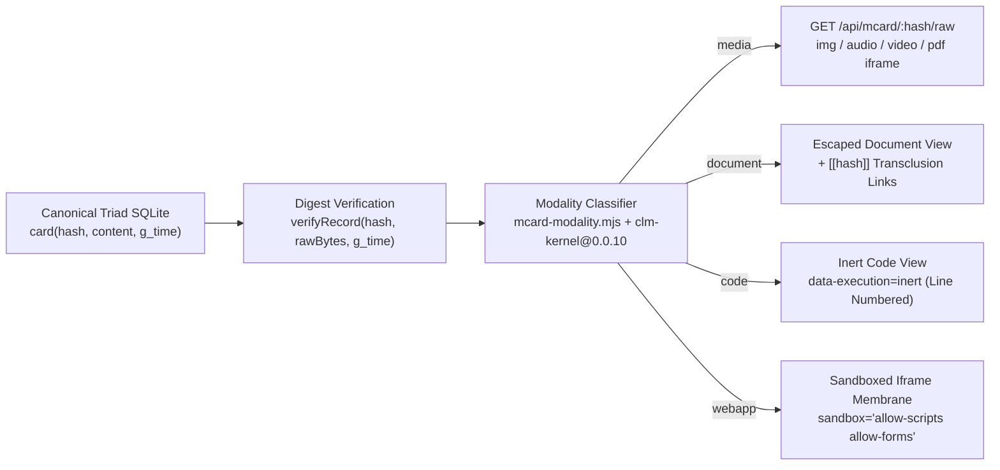

# Universal 4-Modality MCard Content Browser Architecture

**Status**: Active (`Program SMO`, Sprints `SMO-01` through `SMO-05`)
**Consensus Kernel**: `clm-kernel@0.0.10` (`npm:clm-kernel`)
**Canonical Storage**: 3-table, 3-column SQLite Triad (`card`, `handle_registry`, `handle_history`)

---

## 1. Consumer and Operator Outcome

`LandingPage` operates as the **Universal MCard Content Browser** and **Responsive UI Lab** (Estate 3 of the `MCard_TDD` four-estate workspace). Every artifact stored in the canonical SQLite Triad (`card(hash, content, g_time)`) is browsable through a single content-addressed pipeline without bespoke per-feature backends.

An operator or automated Playwright harness can ingest, verify, and browse any MCard payload across four universal content modalities (`media`, `document`, `code`, `webapp`) while preserving hash integrity and strict execution isolation.

---

## 2. The Four Universal Content Modalities

`LandingPage/server/mcard-modality.mjs` delegates byte-level magic-number inspection, extension resolution, and structural classification to the published `clm-kernel@0.0.10` package (`TypeInterpreter`, `detectMime`, `isBinary`) and maps every card onto one of four modalities:

| Modality | Canonical MIME Families | Server & Browser Pipeline | Execution Isolation Contract |
| :--- | :--- | :--- | :--- |
| **1. `media`** (Static Media Files) | `image/*`, `audio/*`, `video/*`, `application/pdf`, `model/*`, `application/octet-stream` | Binary-safe `CanonicalTriadBackend.get(hash)` verifies the `blake3` or `sha256` digest over `rawBytes` before decoding. Streamed via `GET /api/mcard/:hash/raw` with `X-Content-Type-Options: nosniff`. Projected via ``, `<audio controls>`, `<video controls>`, or sandboxed PDF `<iframe>`. | Zero script execution. Strict `Content-Security-Policy` (`default-src 'none'; img-src 'self' data: blob:; media-src 'self' data: blob:`). |
| **2. `document`** (Text & Structured Documents) | `text/markdown`, `text/plain`, `application/json`, `application/x-yaml`, `application/x-latex` | Stored as UTF-8 bytes in `card.content`. Projected via `renderPage()` (`mcard-document-body`), `MarkdownRenderer`, `TextRenderer`, `JsonRenderer`, and `LaTeXRenderer` with `[[hash]]` and `[[handle\|label]]` transclusion links. | All raw HTML entities (`&`, `<`, `>`, `"`, `'`) are escaped prior to transclusion link resolution. |
| **3. `code`** (Source Code & CLM Descriptors) | `application/javascript`, `text/javascript`, `application/typescript`, `text/css`, `text/x-python`, `text/x-rust`, `text/x-sql`, `application/x-clm` | Classified by `TypeInterpreter` (`category: 'code'`) or CLM triad structural markers (`abstract_spec` / `concrete_impl` / `balanced_exp`). Projected via inert line-numbered `<pre class="mcard-code-body" data-modality="code" data-execution="inert">` or `CLMRenderer` in inspect mode. | **Inert Inspection Law (`INV-SMO-04`)**: Browsing a `code` MCard never evaluates or executes the code payload. |
| **4. `webapp`** (Executable Web Pages & Portals) | `text/html`, `text/uri-list`, `external-url: https://...` | Inline `text/html` MCards are projected into `<iframe class="mcard-webapp-frame" sandbox="allow-scripts allow-forms" referrerpolicy="no-referrer" srcdoc="...">`. External/local portal URLs are probed via `GET /api/mcard/probe-url` (`mcard-probe-policy.mjs`) and mounted via `external-portal-membrane.js` (`live` / `snapshot` / `offline`). Supports toggling `{ viewMode: 'source' }` to inspect raw HTML inertly as `code`. | **Membrane Isolation Law**: `allow-same-origin` is omitted from all untrusted `webapp` iframes; telemetry uses fail-closed `postMessage` validation (`mcard-portal-telemetry/v1`). |

---

## 3. End-to-End Architecture Flow

---

## 4. Key Implementation Modules

- [server/mcard-api.mjs](../../server/mcard-api.mjs) - Canonical 3-table, 3-column Triad SQLite backend (`CanonicalTriadBackend`) and REST routes (`GET /api/mcard`, `POST /api/mcard`, `GET /api/mcard/landing`, `PUT /api/mcard/landing`, `GET /api/mcard/probe-url`, `GET /api/mcard/:hash`, `GET /api/mcard/:hash/raw`).
- [server/mcard-modality.mjs](../../server/mcard-modality.mjs) - Universal 4-modality classifier backed by `clm-kernel@0.0.10` (`TypeInterpreter`, `detectMime`, `isBinary`).
- [server/mcard-probe-policy.mjs](../../server/mcard-probe-policy.mjs) - SSRF guard, DNS-rebinding validator, redirect hop inspector, and `X-Frame-Options` / `CSP frame-ancestors` policy evaluator.
- [js/landing-page-mcard.js](../../js/landing-page-mcard.js) - Single-page universal 4-modality MCard browser controller and Sovereign HUD Pill (`#mcard-sovereign-pill`).
- [js/external-portal-membrane.js](../../js/external-portal-membrane.js) - Three-state external portal membrane (`live`, `snapshot`, `offline`) and `mcard-portal-telemetry/v1` receiver.
- [js/renderers/BaseRenderer.js](../../js/renderers/BaseRenderer.js) and [js/renderers/EmbedRenderer.js](../../js/renderers/EmbedRenderer.js) - Browser-side renderer base class and sandboxed embed renderer.
- [tests/single-page-mcard.test.mjs](../../tests/single-page-mcard.test.mjs) - 24-test automated verification suite covering Triad storage, binary media streaming, `clm-kernel@0.0.10` consensus, 4-modality rendering, and SSRF/sandbox negative controls.
