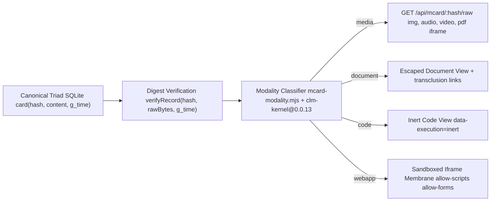

# Universal 4-Modality MCard Content Browser Architecture

| Field | Value |
| --- | --- |
| Audience | Developers, architects, and QA engineers working on MCard ingestion, modality classification, and viewer isolation |
| BMAD Owner | Architect (`bmad-agent-architect`) and Product Manager (`bmad-agent-pm`) |
| Source of Truth | [`server/mcard-api.mjs`](../../server/mcard-api.mjs), [`server/mcard-modality.mjs`](../../server/mcard-modality.mjs), [`js/landing-page-mcard.js`](../../js/landing-page-mcard.js), and [`package.json`](../../package.json) |
| Consensus Kernel | `clm-kernel@0.0.13` (`KERNEL_PROVENANCE = 'clm-kernel@0.0.13'`) |
| Canonical Storage | 3-table, 3-column SQLite Triad (`card`, `handle_registry`, `handle_history`) |

---

## 1. Surface Role and Operator Outcome

`LandingPage` serves as **Estate 4 (Submodule 3)** of the `MCard_TDD` workspace. While `/responsive-lab.html` (`p_page_responsive_lab`) is the primary Responsive UI Lab workbench, `/?noredirect=1` and `/index.html?noredirect=1` (`p_view_index_mcard_viewer`) expose the **Single-Page Universal 4-Modality MCard Viewer**, distinct from the legacy Mission Control IndexedDB host at `/app.html` (`p_page_app`).

Every artifact stored in the SQLite Triad (`card(hash, content, g_time)`) is browsable through one content-addressed pipeline across four modalities (`media`, `document`, `code`, `webapp`) while preserving Triad Blake3 integrity (`clm-kernel@0.0.13`) and strict execution isolation. Historical references to `clm-kernel@0.0.10` in graduated SMO sprint records denote the earlier SMO baseline superseded by `0.0.13`.

---

## 2. The Four Universal Content Modalities

[`server/mcard-modality.mjs`](../../server/mcard-modality.mjs) delegates magic-number inspection, extension resolution, and structural classification to `clm-kernel@0.0.13` (`TypeInterpreter`, `detectMime`, `isBinary`) and maps every card onto one of four modalities.

| Modality | Canonical MIME Families | Server and Browser Pipeline | Execution Isolation Contract |
| :--- | :--- | :--- | :--- |
| **1. `media`** | `image/*`, `audio/*`, `video/*`, `application/pdf`, `model/*`, `application/octet-stream` | `CanonicalTriadBackend.get(hash)` verifies the `blake3` or `sha256` digest over `rawBytes` before streaming via `GET /api/mcard/:hash/raw` with `X-Content-Type-Options: nosniff`. Projected via ``, `<audio controls>`, `<video controls>`, or sandboxed PDF `<iframe>`. | Zero script execution under strict media CSP headers. |
| **2. `document`** | `text/markdown`, `text/plain`, `application/json`, `application/x-yaml`, `application/x-latex` | Stored as UTF-8 bytes in `card.content`. Projected via `renderPage()` (`mcard-document-body`) with `[[hash]]` and `[[handle\|label]]` transclusion links. | Raw HTML entities (`&`, `<`, `>`, `"`, `'`) are escaped prior to transclusion link resolution. |
| **3. `code`** | `application/javascript`, `text/javascript`, `application/typescript`, `text/css`, `text/x-python`, `text/x-rust`, `text/x-sql`, `application/clm` | Classified by `TypeInterpreter` (`category: 'code'`) or CLM triad structural markers (`abstract_spec`, `concrete_impl`, `balanced_exp`). Projected via inert line-numbered `<pre class="mcard-code-body" data-modality="code" data-execution="inert">`. | **Inert Inspection Law (`INV-SMO-04`)** ensures browsing a `code` MCard never evaluates or executes the payload. |
| **4. `webapp`** | `text/html`, `text/uri-list`, `external-url: https://...` | Inline `text/html` MCards render inside `<iframe class="mcard-webapp-frame" sandbox="allow-scripts allow-forms" referrerpolicy="no-referrer" srcdoc="...">`. External URLs probe through `GET /api/mcard/probe-url` (`mcard-probe-policy.mjs`) and mount via `external-portal-membrane.js` (`live`, `snapshot`, `offline`). Supports `{ viewMode: 'source' }` to inspect raw HTML inertly as `code`. | **Membrane Isolation Law** omits `allow-same-origin` from untrusted `webapp` iframes and validates `mcard-portal-telemetry/v1` messages fail-closed. |

---

## 3. End-to-End Architecture Flow

---

## 4. Key Implementation Modules

- [`server/mcard-api.mjs`](../../server/mcard-api.mjs) implements `CanonicalTriadBackend` (`card`, `handle_registry`, `handle_history`) and REST routes (`/api/mcard`, `/api/mcard/landing`, `/api/mcard/probe-url`, `/api/mcard/:hash`, `/api/mcard/:hash/raw`).
- [`server/mcard-modality.mjs`](../../server/mcard-modality.mjs) implements the 4-modality classifier backed by `clm-kernel@0.0.13`.
- [`server/mcard-probe-policy.mjs`](../../server/mcard-probe-policy.mjs) implements the SSRF guard, DNS-rebinding validator, redirect hop inspector, and framing header evaluator.
- [`js/landing-page-mcard.js`](../../js/landing-page-mcard.js) implements the single-page 4-modality MCard viewer and Sovereign HUD Pill (`#mcard-sovereign-pill`) on `/?noredirect=1`.
- [`js/external-portal-membrane.js`](../../js/external-portal-membrane.js) implements the three-state external portal membrane (`live`, `snapshot`, `offline`).
- [`js/renderers/BaseRenderer.js`](../../js/renderers/BaseRenderer.js) and [`js/renderers/EmbedRenderer.js`](../../js/renderers/EmbedRenderer.js) implement the separate MIME-keyed component isolation renderers.
- [`tests/single-page-mcard.test.mjs`](../../tests/single-page-mcard.test.mjs) and [`tests/smoke/single-page-mcard.spec.js`](../../tests/smoke/single-page-mcard.spec.js) verify Triad storage, binary media streaming, `clm-kernel@0.0.13` modality classification, and sandbox negative controls.
