# Workbench Navigation Net Reference

| Field | Value |
| --- | --- |
| Audience | Developers, architects, and QA engineers inspecting workbench Places, Transitions, and recovery paths |
| BMAD Owner | Architect (`bmad-agent-architect`) and Test Architect |
| Source of Truth | [`src/net/workbench-net.yaml`](../../src/net/workbench-net.yaml) via [`scripts/gen-net-docs.mjs`](../../scripts/gen-net-docs.mjs) |
| Drift Gate | `npm run docs:check` (`GQC-07-UNIT-06`) and `npm run check:net` |

> [!IMPORTANT]
> This file is generated deterministically from [`src/net/workbench-net.yaml`](../../src/net/workbench-net.yaml) by `npm run docs:gen-net`. Do not hand-edit tables or diagrams here. Edit `src/net/workbench-net.yaml` and re-run `npm run docs:gen-net`.

## Net Envelope Summary

| Property | Value |
| --- | --- |
| Schema | `urn:gqc:net-envelope:v1` |
| Net ID | `landingpage-workbench-net` |
| Target Handle | `mcard:workbench:landing-page` |
| Entry Place | `p_page_index` |
| Total Places | 31 |
| Total Transitions | 65 |
| Non-UI Programmatic Endpoints | 23 |

Related architecture guides include [LandingPage Architecture](./landing-page-architecture.md) and [Astro Host and Preact Islands](./astro-host-and-islands.md).

### Place Counts by Kind

| Place Kind | Count |
| --- | --- |
| `error` | 9 |
| `external` | 1 |
| `page` | 6 |
| `pending` | 14 |
| `view` | 1 |

### Transition Counts by Kind

| Transition Kind | Count |
| --- | --- |
| `client-route` | 3 |
| `link` | 6 |
| `open-external` | 3 |
| `recover` | 9 |
| `redirect` | 1 |
| `server-call-fail` | 15 |
| `server-call-ok` | 14 |
| `server-call-request` | 14 |

## Places

| Place ID | Kind | Route | Route Handle | CLM Type URI | Migration State | Entry Mode | Owner | Description |
| --- | --- | --- | --- | --- | --- | --- | --- | --- |
| `p_page_index` | `page` | `/` | `mcard:route:/index.html` | `clm://type/view/workbench/landing-portal` | `astro-wrapped` | entry | Product Manager and UX Designer | Workbench root entry route that redirects top-level requests to Responsive UI Lab |
| `p_page_responsive_lab` | `page` | `/responsive-lab.html` | `mcard:route:/responsive-lab.html` | `clm://type/view/workbench/responsive-lab` | `astro-islands` | deep-link | Product Manager and TEA | Primary P0 Responsive UI Lab full-window viewport workbench |
| `p_page_app` | `page` | `/app.html` | `mcard:route:/app.html` | `clm://type/view/legacy/mission-control` | `astro-wrapped` | deep-link | Product Manager | Legacy Mission Control MCard Manager host page |
| `p_page_sprint_registry` | `page` | `/sprint-registry.html` | `mcard:route:/sprint-registry.html` | `clm://type/view/diagnostic/sprint-registry` | `astro-wrapped` | deep-link | Scrum Master | Internal CLM sprint registry catalog page |
| `p_page_fiber_inspector` | `page` | `/fiber-inspector.html` | `mcard:route:/fiber-inspector.html` | `clm://type/view/diagnostic/fiber-inspector` | `astro-wrapped` | deep-link | Architect | Internal fiber correctness and marking inspector page |
| `p_page_fiber_conformance` | `page` | `/fiber-conformance.html` | `mcard:route:/fiber-conformance.html` | `clm://type/view/diagnostic/fiber-conformance` | `astro-wrapped` | deep-link | Architect | Internal fiber conformance harness page |
| `p_view_index_mcard_viewer` | `view` | `/index.html?noredirect=1` | `mcard:route:/index.html?noredirect=1` | `clm://type/view/workbench/mcard-viewer` | n/a | deep-link | Product Manager and UX Designer | Single-page 4-modality MCard viewer mode on index.html?noredirect=1 |
| `p_external_games` | `external` | `/public/examples/games/*` | `mcard:external:/public/examples/games` | `clm://type/view/external/games` | n/a | reachable | Product Manager | External game popup windows launched from app.html via window.open |
| `p_pending_get_app_config` | `pending` | `/responsive-lab.html` | `mcard:pending:get_app_config` | `clm://type/view/workbench/pending/get-app-config` | n/a | reachable | Product Manager and TEA | In-flight pending state for GET /app-config.json from p_page_responsive_lab |
| `p_pending_post_test_runs` | `pending` | `/responsive-lab.html` | `mcard:pending:post_test_runs` | `clm://type/view/workbench/pending/post-test-runs` | n/a | reachable | Product Manager and TEA | In-flight pending state for POST /api/test-runs from p_page_responsive_lab |
| `p_error_post_test_runs` | `error` | `/responsive-lab.html` | `mcard:error:post_test_runs` | `clm://type/view/workbench/error/post-test-runs` | n/a | reachable | Product Manager and TEA | Recoverable error state for POST /api/test-runs on responsive-lab.html |
| `p_pending_get_conformance_latest` | `pending` | `/responsive-lab.html` | `mcard:pending:get_conformance_latest` | `clm://type/view/workbench/pending/get-conformance-latest` | n/a | reachable | Product Manager and TEA | In-flight pending state for GET /api/test-runs/conformance/latest from p_page_responsive_lab |
| `p_pending_get_env` | `pending` | `/index.html?noredirect=1` | `mcard:pending:get_env` | `clm://type/view/workbench/pending/get-env` | n/a | reachable | Product Manager and UX Designer | In-flight pending state for GET /api/env from p_view_index_mcard_viewer |
| `p_pending_get_mcard_landing` | `pending` | `/index.html?noredirect=1` | `mcard:pending:get_mcard_landing` | `clm://type/view/workbench/pending/get-mcard-landing` | n/a | reachable | Product Manager | In-flight pending state for GET /api/mcard/landing from p_view_index_mcard_viewer |
| `p_pending_put_mcard_landing` | `pending` | `/index.html?noredirect=1` | `mcard:pending:put_mcard_landing` | `clm://type/view/workbench/pending/put-mcard-landing` | n/a | reachable | Product Manager | In-flight pending state for PUT /api/mcard/landing from p_view_index_mcard_viewer |
| `p_error_put_mcard_landing` | `error` | `/index.html?noredirect=1` | `mcard:error:put_mcard_landing` | `clm://type/view/workbench/error/put-mcard-landing` | n/a | reachable | Product Manager | Recoverable error state for PUT /api/mcard/landing on index.html |
| `p_pending_get_clm_program_artifact` | `pending` | `/index.html?noredirect=1` | `mcard:pending:get_clm_program_artifact` | `clm://type/view/workbench/pending/get-clm-program-artifact` | n/a | reachable | Architect | In-flight pending state for GET /api/clm/program-artifact from p_view_index_mcard_viewer |
| `p_pending_get_clm_registry` | `pending` | `/sprint-registry.html` | `mcard:pending:get_clm_registry` | `clm://type/view/workbench/pending/get-clm-registry` | n/a | reachable | Scrum Master | In-flight pending state for GET /api/clm/registry from p_page_sprint_registry |
| `p_error_get_clm_registry` | `error` | `/sprint-registry.html` | `mcard:error:get_clm_registry` | `clm://type/view/workbench/error/get-clm-registry` | n/a | reachable | Scrum Master | Recoverable error state for GET /api/clm/registry on sprint-registry.html |
| `p_pending_get_fiber_inspector_harness` | `pending` | `/fiber-inspector.html` | `mcard:pending:get_fiber_inspector_harness` | `clm://type/view/workbench/pending/get-fiber-inspector-harness` | n/a | reachable | Architect | In-flight pending state for GET /public/conformance/harness-data.json from p_page_fiber_inspector |
| `p_error_get_fiber_inspector_harness` | `error` | `/fiber-inspector.html` | `mcard:error:get_fiber_inspector_harness` | `clm://type/view/workbench/error/get-fiber-inspector-harness` | n/a | reachable | Architect | Recoverable error state for GET /public/conformance/harness-data.json on fiber-inspector.html |
| `p_pending_get_fiber_conformance_harness` | `pending` | `/fiber-conformance.html` | `mcard:pending:get_fiber_conformance_harness` | `clm://type/view/workbench/pending/get-fiber-conformance-harness` | n/a | reachable | Architect | In-flight pending state for GET /public/conformance/harness-data.json from p_page_fiber_conformance |
| `p_error_get_fiber_conformance_harness` | `error` | `/fiber-conformance.html` | `mcard:error:get_fiber_conformance_harness` | `clm://type/view/workbench/error/get-fiber-conformance-harness` | n/a | reachable | Architect | Recoverable error state for GET /public/conformance/harness-data.json on fiber-conformance.html |
| `p_pending_probe_handshake` | `pending` | `/responsive-lab.html` | `mcard:pending:probe_handshake` | `clm://type/view/workbench/pending/probe-handshake` | n/a | reachable | Architect and TEA | In-flight postMessage probe handshake state from p_page_responsive_lab |
| `p_error_target_blocked` | `error` | `/responsive-lab.html` | `mcard:error:target_blocked` | `clm://type/view/workbench/error/target-blocked` | n/a | reachable | Product Manager and UX Designer | Recoverable blocked-target policy state on responsive-lab.html |
| `p_error_capture_unavailable` | `error` | `/responsive-lab.html` | `mcard:error:capture_unavailable` | `clm://type/view/workbench/error/capture-unavailable` | n/a | reachable | Product Manager, Architect, and UX Designer | Recoverable capture-unavailable policy state on responsive-lab.html |
| `p_error_handshake_timeout` | `error` | `/responsive-lab.html` | `mcard:error:handshake_timeout` | `clm://type/view/workbench/error/handshake-timeout` | n/a | reachable | Product Manager, Architect, and UX Designer | Recoverable 5000ms probe handshake timeout state on responsive-lab.html |
| `p_error_target_unapproved` | `error` | `/responsive-lab.html` | `mcard:error:target_unapproved` | `clm://type/view/workbench/error/target-unapproved` | n/a | reachable | Product Manager and Security Owner | Recoverable unapproved or malformed custom target state on responsive-lab.html |
| `p_pending_post_nav_session` | `pending` | `/responsive-lab.html` | `mcard:pending:post_nav_session` | `clm://type/view/workbench/pending/post-nav-session` | n/a | reachable | Architect and TEA | In-flight pending state for POST /api/test-runs/navigation/session from p_page_responsive_lab |
| `p_pending_post_nav_fire` | `pending` | `/responsive-lab.html` | `mcard:pending:post_nav_fire` | `clm://type/view/workbench/pending/post-nav-fire` | n/a | reachable | Architect and TEA | In-flight pending state for POST /api/test-runs/navigation/fire from p_page_responsive_lab |
| `p_pending_post_nav_link` | `pending` | `/responsive-lab.html` | `mcard:pending:post_nav_link` | `clm://type/view/workbench/pending/post-nav-link` | n/a | reachable | Architect and TEA | In-flight pending state for POST /api/test-runs/navigation/link from p_page_responsive_lab |

## Transitions

| Transition ID | Kind | From Place | To Place | Endpoint or Route | Owner Page | Owner | Trigger |
| --- | --- | --- | --- | --- | --- | --- | --- |
| `t_redirect_index_to_lab` | `redirect` | `p_page_index` | `p_page_responsive_lab` | `/responsive-lab.html` | `index.html` | Product Manager and UX Designer | window.location.replace("responsive-lab.html") at index.html:13 |
| `t_link_lab_to_index` | `link` | `p_page_responsive_lab` | `p_page_index` | `/` | `responsive-lab.html` | Product Manager and TEA | click a#btn-back-home[href="/"] at responsive-lab.html:875 |
| `t_link_lab_to_app` | `link` | `p_page_responsive_lab` | `p_page_app` | `/app.html` | `responsive-lab.html` | Product Manager and TEA | click a#btn-nav-mission-control[href="app.html"] at responsive-lab.html:898 |
| `t_link_app_to_index` | `link` | `p_page_app` | `p_page_index` | `/` | `app.html` | Product Manager | click button.header-btn onclick window.location.href="/" at app.html:76 |
| `t_link_viewer_to_index` | `link` | `p_view_index_mcard_viewer` | `p_page_index` | `/index.html` | `index.html` | Product Manager and UX Designer | click a.penpot-nav-link[href="index.html"] at index.html:279 |
| `t_link_viewer_to_app` | `link` | `p_view_index_mcard_viewer` | `p_page_app` | `/app.html` | `index.html` | Product Manager and UX Designer | click a.penpot-nav-link[href="app.html"] at index.html:280 |
| `t_link_viewer_to_lab` | `link` | `p_view_index_mcard_viewer` | `p_page_responsive_lab` | `/responsive-lab.html` | `index.html` | Product Manager and UX Designer | click a[href="responsive-lab.html"] at index.html:281,293,323 or openResponsiveUILab at index.html:482 |
| `t_open_external_monopoly` | `open-external` | `p_page_app` | `p_page_app` | `/public/examples/games/monopoly-auth.html` | `app.html` | Product Manager | window.open("/public/examples/games/monopoly-auth.html", "_blank") at app.html:284 |
| `t_open_external_chess` | `open-external` | `p_page_app` | `p_page_app` | `/public/examples/games/chess-auth.html` | `app.html` | Product Manager | window.open("/public/examples/games/chess-auth.html", "_blank") at app.html:316 |
| `t_open_external_go` | `open-external` | `p_page_app` | `p_page_app` | `/public/examples/games/go-auth.html` | `app.html` | Product Manager | window.open("/public/examples/games/go-auth.html", "_blank") at app.html:348 |
| `t_req_get_app_config` | `server-call-request` | `p_page_responsive_lab` | `p_pending_get_app_config` | `GET /app-config.json` | `responsive-lab.html` | Product Manager and TEA | fetch("/app-config.json") in js/harness/lab-toolbar.js:175 |
| `t_ok_get_app_config` | `server-call-ok` | `p_pending_get_app_config` | `p_page_responsive_lab` | `GET /app-config.json` | `responsive-lab.html` | Product Manager and TEA | HTTP 2xx response for GET /app-config.json |
| `t_fail_get_app_config` | `server-call-fail` | `p_pending_get_app_config` | `p_page_responsive_lab` | `GET /app-config.json` | `responsive-lab.html` | Product Manager and TEA | HTTP 4xx/5xx or network failure for GET /app-config.json |
| `t_req_post_test_runs` | `server-call-request` | `p_page_responsive_lab` | `p_pending_post_test_runs` | `POST /api/test-runs` | `responsive-lab.html` | Product Manager and TEA | fetch("/api/test-runs", { method: "POST" }) in js/harness/recorder.js:219 |
| `t_ok_post_test_runs` | `server-call-ok` | `p_pending_post_test_runs` | `p_page_responsive_lab` | `POST /api/test-runs` | `responsive-lab.html` | Product Manager and TEA | HTTP 2xx response for POST /api/test-runs |
| `t_fail_post_test_runs` | `server-call-fail` | `p_pending_post_test_runs` | `p_error_post_test_runs` | `POST /api/test-runs` | `responsive-lab.html` | Product Manager and TEA | HTTP 4xx/5xx or network failure for POST /api/test-runs |
| `t_recover_post_test_runs` | `recover` | `p_error_post_test_runs` | `p_page_responsive_lab` | `/responsive-lab.html` | `responsive-lab.html` | Product Manager and TEA | Reload or reset responsive-lab.html to /responsive-lab.html from p_error_post_test_runs |
| `t_req_get_conformance_latest` | `server-call-request` | `p_page_responsive_lab` | `p_pending_get_conformance_latest` | `GET /api/test-runs/conformance/latest` | `responsive-lab.html` | Product Manager and TEA | fetch("/api/test-runs/conformance/latest?target=...") in js/harness/conformance-panel.js:25 |
| `t_ok_get_conformance_latest` | `server-call-ok` | `p_pending_get_conformance_latest` | `p_page_responsive_lab` | `GET /api/test-runs/conformance/latest` | `responsive-lab.html` | Product Manager and TEA | HTTP 2xx response for GET /api/test-runs/conformance/latest |
| `t_fail_get_conformance_latest` | `server-call-fail` | `p_pending_get_conformance_latest` | `p_page_responsive_lab` | `GET /api/test-runs/conformance/latest` | `responsive-lab.html` | Product Manager and TEA | HTTP 4xx/5xx or network failure for GET /api/test-runs/conformance/latest |
| `t_req_post_nav_session` | `server-call-request` | `p_page_responsive_lab` | `p_pending_post_nav_session` | `POST /api/test-runs/navigation/session` | `responsive-lab.html` | Architect and TEA | fetch("/api/test-runs/navigation/session") in js/harness/spa-test-workflow.js |
| `t_ok_post_nav_session` | `server-call-ok` | `p_pending_post_nav_session` | `p_page_responsive_lab` | `POST /api/test-runs/navigation/session` | `responsive-lab.html` | Architect and TEA | HTTP 2xx response for POST /api/test-runs/navigation/session |
| `t_fail_post_nav_session` | `server-call-fail` | `p_pending_post_nav_session` | `p_page_responsive_lab` | `POST /api/test-runs/navigation/session` | `responsive-lab.html` | Architect and TEA | HTTP 4xx/5xx or network failure for POST /api/test-runs/navigation/session |
| `t_req_post_nav_fire` | `server-call-request` | `p_page_responsive_lab` | `p_pending_post_nav_fire` | `POST /api/test-runs/navigation/fire` | `responsive-lab.html` | Architect and TEA | fetch("/api/test-runs/navigation/fire") in js/harness/spa-test-workflow.js |
| `t_ok_post_nav_fire` | `server-call-ok` | `p_pending_post_nav_fire` | `p_page_responsive_lab` | `POST /api/test-runs/navigation/fire` | `responsive-lab.html` | Architect and TEA | HTTP 2xx response for POST /api/test-runs/navigation/fire |
| `t_fail_post_nav_fire` | `server-call-fail` | `p_pending_post_nav_fire` | `p_page_responsive_lab` | `POST /api/test-runs/navigation/fire` | `responsive-lab.html` | Architect and TEA | HTTP 4xx/5xx or network failure for POST /api/test-runs/navigation/fire |
| `t_req_post_nav_link` | `server-call-request` | `p_page_responsive_lab` | `p_pending_post_nav_link` | `POST /api/test-runs/navigation/link` | `responsive-lab.html` | Architect and TEA | fetch("/api/test-runs/navigation/link") in js/harness/spa-test-workflow.js |
| `t_ok_post_nav_link` | `server-call-ok` | `p_pending_post_nav_link` | `p_page_responsive_lab` | `POST /api/test-runs/navigation/link` | `responsive-lab.html` | Architect and TEA | HTTP 2xx response for POST /api/test-runs/navigation/link |
| `t_fail_post_nav_link` | `server-call-fail` | `p_pending_post_nav_link` | `p_page_responsive_lab` | `POST /api/test-runs/navigation/link` | `responsive-lab.html` | Architect and TEA | HTTP 4xx/5xx or network failure for POST /api/test-runs/navigation/link |
| `t_req_get_env` | `server-call-request` | `p_view_index_mcard_viewer` | `p_pending_get_env` | `GET /api/env` | `index.html` | Product Manager and UX Designer | fetch("/api/env") in index.html:351 |
| `t_ok_get_env` | `server-call-ok` | `p_pending_get_env` | `p_view_index_mcard_viewer` | `GET /api/env` | `index.html` | Product Manager and UX Designer | HTTP 2xx response for GET /api/env |
| `t_fail_get_env` | `server-call-fail` | `p_pending_get_env` | `p_view_index_mcard_viewer` | `GET /api/env` | `index.html` | Product Manager and UX Designer | HTTP 4xx/5xx or network failure for GET /api/env |
| `t_req_get_mcard_landing` | `server-call-request` | `p_view_index_mcard_viewer` | `p_pending_get_mcard_landing` | `GET /api/mcard/landing` | `index.html` | Product Manager | api.landing() GET /api/mcard/landing in js/landing-page-mcard.js:176,199 |
| `t_ok_get_mcard_landing` | `server-call-ok` | `p_pending_get_mcard_landing` | `p_view_index_mcard_viewer` | `GET /api/mcard/landing` | `index.html` | Product Manager | HTTP 2xx response for GET /api/mcard/landing |
| `t_fail_get_mcard_landing` | `server-call-fail` | `p_pending_get_mcard_landing` | `p_view_index_mcard_viewer` | `GET /api/mcard/landing` | `index.html` | Product Manager | HTTP 4xx/5xx or network failure for GET /api/mcard/landing |
| `t_req_put_mcard_landing` | `server-call-request` | `p_view_index_mcard_viewer` | `p_pending_put_mcard_landing` | `PUT /api/mcard/landing` | `index.html` | Product Manager | api.setLanding() PUT /api/mcard/landing in js/landing-page-mcard.js:177,216 |
| `t_ok_put_mcard_landing` | `server-call-ok` | `p_pending_put_mcard_landing` | `p_view_index_mcard_viewer` | `PUT /api/mcard/landing` | `index.html` | Product Manager | HTTP 2xx response for PUT /api/mcard/landing |
| `t_fail_put_mcard_landing` | `server-call-fail` | `p_pending_put_mcard_landing` | `p_error_put_mcard_landing` | `PUT /api/mcard/landing` | `index.html` | Product Manager | HTTP 4xx/5xx or network failure for PUT /api/mcard/landing |
| `t_recover_put_mcard_landing` | `recover` | `p_error_put_mcard_landing` | `p_view_index_mcard_viewer` | `/index.html?noredirect=1` | `index.html` | Product Manager | Reload or reset index.html to /index.html?noredirect=1 from p_error_put_mcard_landing |
| `t_req_get_clm_program_artifact` | `server-call-request` | `p_view_index_mcard_viewer` | `p_pending_get_clm_program_artifact` | `GET /api/clm/program-artifact` | `index.html` | Architect | fetch("/api/clm/program-artifact?...") in js/observability/fibration-dashboard.js:157 |
| `t_ok_get_clm_program_artifact` | `server-call-ok` | `p_pending_get_clm_program_artifact` | `p_view_index_mcard_viewer` | `GET /api/clm/program-artifact` | `index.html` | Architect | HTTP 2xx response for GET /api/clm/program-artifact |
| `t_fail_get_clm_program_artifact` | `server-call-fail` | `p_pending_get_clm_program_artifact` | `p_view_index_mcard_viewer` | `GET /api/clm/program-artifact` | `index.html` | Architect | HTTP 4xx/5xx or network failure for GET /api/clm/program-artifact |
| `t_req_get_clm_registry` | `server-call-request` | `p_page_sprint_registry` | `p_pending_get_clm_registry` | `GET /api/clm/registry` | `sprint-registry.html` | Scrum Master | fetch("/api/clm/registry") in sprint-registry.html:140 |
| `t_ok_get_clm_registry` | `server-call-ok` | `p_pending_get_clm_registry` | `p_page_sprint_registry` | `GET /api/clm/registry` | `sprint-registry.html` | Scrum Master | HTTP 2xx response for GET /api/clm/registry |
| `t_fail_get_clm_registry` | `server-call-fail` | `p_pending_get_clm_registry` | `p_error_get_clm_registry` | `GET /api/clm/registry` | `sprint-registry.html` | Scrum Master | HTTP 4xx/5xx or network failure for GET /api/clm/registry |
| `t_recover_get_clm_registry` | `recover` | `p_error_get_clm_registry` | `p_page_sprint_registry` | `/sprint-registry.html` | `sprint-registry.html` | Scrum Master | Reload or reset sprint-registry.html to /sprint-registry.html from p_error_get_clm_registry |
| `t_req_get_fiber_inspector_harness` | `server-call-request` | `p_page_fiber_inspector` | `p_pending_get_fiber_inspector_harness` | `GET /public/conformance/harness-data.json` | `fiber-inspector.html` | Architect | fetch("./public/conformance/harness-data.json") gating JSON in fiber-inspector.html:72 |
| `t_ok_get_fiber_inspector_harness` | `server-call-ok` | `p_pending_get_fiber_inspector_harness` | `p_page_fiber_inspector` | `GET /public/conformance/harness-data.json` | `fiber-inspector.html` | Architect | HTTP 2xx response for GET /public/conformance/harness-data.json |
| `t_fail_get_fiber_inspector_harness` | `server-call-fail` | `p_pending_get_fiber_inspector_harness` | `p_error_get_fiber_inspector_harness` | `GET /public/conformance/harness-data.json` | `fiber-inspector.html` | Architect | HTTP 4xx/5xx or network failure for GET /public/conformance/harness-data.json |
| `t_recover_get_fiber_inspector_harness` | `recover` | `p_error_get_fiber_inspector_harness` | `p_page_fiber_inspector` | `/fiber-inspector.html` | `fiber-inspector.html` | Architect | Reload or reset fiber-inspector.html to /fiber-inspector.html from p_error_get_fiber_inspector_harness |
| `t_req_get_fiber_conformance_harness` | `server-call-request` | `p_page_fiber_conformance` | `p_pending_get_fiber_conformance_harness` | `GET /public/conformance/harness-data.json` | `fiber-conformance.html` | Architect | fetch("./public/conformance/harness-data.json") gating JSON in fiber-conformance.html:144 |
| `t_ok_get_fiber_conformance_harness` | `server-call-ok` | `p_pending_get_fiber_conformance_harness` | `p_page_fiber_conformance` | `GET /public/conformance/harness-data.json` | `fiber-conformance.html` | Architect | HTTP 2xx response for GET /public/conformance/harness-data.json |
| `t_fail_get_fiber_conformance_harness` | `server-call-fail` | `p_pending_get_fiber_conformance_harness` | `p_error_get_fiber_conformance_harness` | `GET /public/conformance/harness-data.json` | `fiber-conformance.html` | Architect | HTTP 4xx/5xx or network failure for GET /public/conformance/harness-data.json |
| `t_recover_get_fiber_conformance_harness` | `recover` | `p_error_get_fiber_conformance_harness` | `p_page_fiber_conformance` | `/fiber-conformance.html` | `fiber-conformance.html` | Architect | Reload or reset fiber-conformance.html to /fiber-conformance.html from p_error_get_fiber_conformance_harness |
| `t_req_probe_handshake` | `server-call-request` | `p_page_responsive_lab` | `p_pending_probe_handshake` | n/a | `responsive-lab.html` | Architect and TEA | postMessage lab:ping handshake request in js/harness/capture-probe-agent.js |
| `t_ok_probe_handshake` | `server-call-ok` | `p_pending_probe_handshake` | `p_page_responsive_lab` | n/a | `responsive-lab.html` | Architect and TEA | Approved-origin postMessage lab:hello handshake in js/harness/capture-probe-agent.js |
| `t_fail_probe_handshake_unavailable` | `server-call-fail` | `p_pending_probe_handshake` | `p_error_capture_unavailable` | n/a | `responsive-lab.html` | Architect and TEA | Probe handshake rejected or invalidated in js/harness/capture-probe-agent.js |
| `t_fail_probe_handshake_timeout` | `server-call-fail` | `p_pending_probe_handshake` | `p_error_handshake_timeout` | n/a | `responsive-lab.html` | Product Manager, Architect, and UX Designer | 5000ms bounded probe handshake timeout in js/harness/capture-probe-agent.js |
| `t_recover_handshake_timeout` | `recover` | `p_error_handshake_timeout` | `p_page_responsive_lab` | `/responsive-lab.html` | `responsive-lab.html` | Product Manager and UX Designer | Click #btn-target-recover or select approved target on responsive-lab.html |
| `t_enter_target_blocked` | `client-route` | `p_page_responsive_lab` | `p_error_target_blocked` | `/responsive-lab.html` | `responsive-lab.html` | Product Manager and UX Designer | Select status=blocked target in js/harness/target-membrane.js |
| `t_recover_target_blocked` | `recover` | `p_error_target_blocked` | `p_page_responsive_lab` | `/responsive-lab.html` | `responsive-lab.html` | Product Manager and UX Designer | Click #btn-target-recover or select approved target on responsive-lab.html |
| `t_enter_capture_unavailable` | `client-route` | `p_page_responsive_lab` | `p_error_capture_unavailable` | `/responsive-lab.html` | `responsive-lab.html` | Product Manager, Architect, and UX Designer | Select undecided target or capture-unavailable source in js/harness/target-membrane.js |
| `t_recover_capture_unavailable` | `recover` | `p_error_capture_unavailable` | `p_page_responsive_lab` | `/responsive-lab.html` | `responsive-lab.html` | Product Manager and UX Designer | Click #btn-target-recover or select approved target on responsive-lab.html |
| `t_enter_target_unapproved` | `client-route` | `p_page_responsive_lab` | `p_error_target_unapproved` | `/responsive-lab.html` | `responsive-lab.html` | Product Manager and Security Owner | Enter unapproved custom or malformed target URL in js/harness/target-membrane.js |
| `t_recover_target_unapproved` | `recover` | `p_error_target_unapproved` | `p_page_responsive_lab` | `/responsive-lab.html` | `responsive-lab.html` | Product Manager and UX Designer | Click #btn-target-recover or select approved target on responsive-lab.html |

## Non-UI Programmatic Endpoints

| HTTP Method | Path | Source | Status | Owner | Reason |
| --- | --- | --- | --- | --- | --- |
| `GET` | `/health` | `ws-server.js:216` | `not-ui-reachable` | Architect | Infrastructure readiness endpoint for Playwright webServer and probes |
| `GET` | `/api/rooms` | `ws-server.js:228` | `not-ui-reachable` | Architect | Room registry inspection route with zero approved workbench callers |
| `GET` | `/api/config` | `ws-server.js:246` | `not-ui-reachable` | Architect | Called only by standalone developer harness js/modules/webrtc-dashboard/config.js:7 |
| `WS` | `/ws/` | `ws-server.js:188` | `not-ui-reachable` | Product Manager and Architect | WebSocket signaling used only by unmounted net-gateway and undecided P2P demos |
| `GET` | `/api/test-runs` | `server/test-run-api.mjs:298` | `not-ui-reachable` | TEA | Programmatic test-run list endpoint for CLI and unit harnesses |
| `GET` | `/api/test-runs/:hash` | `server/test-run-api.mjs:341` | `not-ui-reachable` | TEA | Programmatic test-run lookup endpoint for playwright-replay-driver.mjs |
| `GET` | `/api/test-runs/latest/history` | `server/test-run-api.mjs:268` | `not-ui-reachable` | TEA | Programmatic test-run history endpoint with zero browser callers |
| `GET` | `/api/test-runs/navigation/link` | `server/test-run-api.mjs` | `not-ui-reachable` | Architect and TEA | Programmatic navigation-run-link reload and Triad verification endpoint for CLI and Playwright harnesses |
| `GET` | `/api/test-runs/conformance/diff` | `server/test-run-api.mjs:157` | `not-ui-reachable` | TEA | Programmatic conformance diff endpoint with zero browser callers |
| `POST` | `/api/auth/token` | `routes/auth.js:38` | `not-ui-reachable` | Product Manager and Security Owner | Zitadel OAuth token exchange belongs to undecided auth capability |
| `POST` | `/api/auth/refresh` | `routes/auth.js:126` | `not-ui-reachable` | Product Manager and Security Owner | Zitadel OAuth refresh belongs to undecided auth capability |
| `POST` | `/api/auth/logout` | `routes/auth.js:175` | `not-ui-reachable` | Product Manager and Security Owner | Zitadel OAuth logout belongs to undecided auth capability |
| `GET` | `/api/clm/component/:id` | `routes/clm.js:63` | `not-ui-reachable` | Architect | CLM component lookup route with zero approved workbench callers |
| `GET` | `/api/clm/health/:componentId` | `routes/clm.js:99` | `not-ui-reachable` | Architect | CLM component health route with zero approved workbench callers |
| `POST` | `/api/clm/telemetry` | `routes/clm.js:116` | `not-ui-reachable` | Architect | Called only by js/clm-iframe-loader.js:285 which has zero root page importers |
| `POST` | `/api/mcard` | `server/mcard-api.mjs:314` | `not-ui-reachable` | Architect | Programmatic MCard write endpoint; app.html persists locally via IndexedDB |
| `GET` | `/api/mcard` | `server/mcard-api.mjs:377` | `not-ui-reachable` | Architect | Programmatic MCard list endpoint with zero browser fetch callers |
| `GET` | `/api/mcard/probe-url` | `server/mcard-api.mjs:372` | `not-ui-reachable` | Product Manager | Defined on createApiClient at js/landing-page-mcard.js:178 with zero UI callers |
| `GET` | `/api/mcard/stats` | `server/mcard-api.mjs:391` | `not-ui-reachable` | Product Manager | Defined on createApiClient at js/landing-page-mcard.js:179 with zero UI callers |
| `GET` | `/api/mcard/search` | `server/mcard-api.mjs:402` | `not-ui-reachable` | Architect | Programmatic MCard search endpoint with zero browser fetch callers |
| `GET` | `/api/mcard/:hash/raw` | `server/mcard-api.mjs:409` | `not-ui-reachable` | Product Manager | Used only as passive media or download URL in js/landing-page-mcard.js:70 |
| `GET` | `/api/mcard/:hash` | `server/mcard-api.mjs:429` | `not-ui-reachable` | Architect | Programmatic MCard get-by-hash endpoint with zero browser fetch callers |
| `DELETE` | `/api/mcard/:hash` | `server/mcard-api.mjs:439` | `not-ui-reachable` | Architect | Programmatic MCard delete endpoint with zero browser fetch callers |

## Workbench Topology Diagram

```mermaid
flowchart TD
  p_page_index["p_page_index (page)"]
  p_page_responsive_lab["p_page_responsive_lab (page)"]
  p_page_app["p_page_app (page)"]
  p_page_sprint_registry["p_page_sprint_registry (page)"]
  p_page_fiber_inspector["p_page_fiber_inspector (page)"]
  p_page_fiber_conformance["p_page_fiber_conformance (page)"]
  p_view_index_mcard_viewer["p_view_index_mcard_viewer (view)"]
  p_external_games["p_external_games (external)"]
  p_pending_get_app_config["p_pending_get_app_config (pending)"]
  p_pending_post_test_runs["p_pending_post_test_runs (pending)"]
  p_error_post_test_runs["p_error_post_test_runs (error)"]
  p_pending_get_conformance_latest["p_pending_get_conformance_latest (pending)"]
  p_pending_get_env["p_pending_get_env (pending)"]
  p_pending_get_mcard_landing["p_pending_get_mcard_landing (pending)"]
  p_pending_put_mcard_landing["p_pending_put_mcard_landing (pending)"]
  p_error_put_mcard_landing["p_error_put_mcard_landing (error)"]
  p_pending_get_clm_program_artifact["p_pending_get_clm_program_artifact (pending)"]
  p_pending_get_clm_registry["p_pending_get_clm_registry (pending)"]
  p_error_get_clm_registry["p_error_get_clm_registry (error)"]
  p_pending_get_fiber_inspector_harness["p_pending_get_fiber_inspector_harness (pending)"]
  p_error_get_fiber_inspector_harness["p_error_get_fiber_inspector_harness (error)"]
  p_pending_get_fiber_conformance_harness["p_pending_get_fiber_conformance_harness (pending)"]
  p_error_get_fiber_conformance_harness["p_error_get_fiber_conformance_harness (error)"]
  p_pending_probe_handshake["p_pending_probe_handshake (pending)"]
  p_error_target_blocked["p_error_target_blocked (error)"]
  p_error_capture_unavailable["p_error_capture_unavailable (error)"]
  p_error_handshake_timeout["p_error_handshake_timeout (error)"]
  p_error_target_unapproved["p_error_target_unapproved (error)"]
  p_pending_post_nav_session["p_pending_post_nav_session (pending)"]
  p_pending_post_nav_fire["p_pending_post_nav_fire (pending)"]
  p_pending_post_nav_link["p_pending_post_nav_link (pending)"]
  p_page_index -->|"t_redirect_index_to_lab (redirect)"| p_page_responsive_lab
  p_page_responsive_lab -->|"t_link_lab_to_index (link)"| p_page_index
  p_page_responsive_lab -->|"t_link_lab_to_app (link)"| p_page_app
  p_page_app -->|"t_link_app_to_index (link)"| p_page_index
  p_view_index_mcard_viewer -->|"t_link_viewer_to_index (link)"| p_page_index
  p_view_index_mcard_viewer -->|"t_link_viewer_to_app (link)"| p_page_app
  p_view_index_mcard_viewer -->|"t_link_viewer_to_lab (link)"| p_page_responsive_lab
  p_page_app -->|"t_open_external_monopoly (open-external)"| p_page_app
  p_page_app -->|"t_open_external_chess (open-external)"| p_page_app
  p_page_app -->|"t_open_external_go (open-external)"| p_page_app
  p_page_responsive_lab -->|"t_req_get_app_config (server-call-request)"| p_pending_get_app_config
  p_pending_get_app_config -->|"t_ok_get_app_config (server-call-ok)"| p_page_responsive_lab
  p_pending_get_app_config -->|"t_fail_get_app_config (server-call-fail)"| p_page_responsive_lab
  p_page_responsive_lab -->|"t_req_post_test_runs (server-call-request)"| p_pending_post_test_runs
  p_pending_post_test_runs -->|"t_ok_post_test_runs (server-call-ok)"| p_page_responsive_lab
  p_pending_post_test_runs -->|"t_fail_post_test_runs (server-call-fail)"| p_error_post_test_runs
  p_error_post_test_runs -->|"t_recover_post_test_runs (recover)"| p_page_responsive_lab
  p_page_responsive_lab -->|"t_req_get_conformance_latest (server-call-request)"| p_pending_get_conformance_latest
  p_pending_get_conformance_latest -->|"t_ok_get_conformance_latest (server-call-ok)"| p_page_responsive_lab
  p_pending_get_conformance_latest -->|"t_fail_get_conformance_latest (server-call-fail)"| p_page_responsive_lab
  p_page_responsive_lab -->|"t_req_post_nav_session (server-call-request)"| p_pending_post_nav_session
  p_pending_post_nav_session -->|"t_ok_post_nav_session (server-call-ok)"| p_page_responsive_lab
  p_pending_post_nav_session -->|"t_fail_post_nav_session (server-call-fail)"| p_page_responsive_lab
  p_page_responsive_lab -->|"t_req_post_nav_fire (server-call-request)"| p_pending_post_nav_fire
  p_pending_post_nav_fire -->|"t_ok_post_nav_fire (server-call-ok)"| p_page_responsive_lab
  p_pending_post_nav_fire -->|"t_fail_post_nav_fire (server-call-fail)"| p_page_responsive_lab
  p_page_responsive_lab -->|"t_req_post_nav_link (server-call-request)"| p_pending_post_nav_link
  p_pending_post_nav_link -->|"t_ok_post_nav_link (server-call-ok)"| p_page_responsive_lab
  p_pending_post_nav_link -->|"t_fail_post_nav_link (server-call-fail)"| p_page_responsive_lab
  p_view_index_mcard_viewer -->|"t_req_get_env (server-call-request)"| p_pending_get_env
  p_pending_get_env -->|"t_ok_get_env (server-call-ok)"| p_view_index_mcard_viewer
  p_pending_get_env -->|"t_fail_get_env (server-call-fail)"| p_view_index_mcard_viewer
  p_view_index_mcard_viewer -->|"t_req_get_mcard_landing (server-call-request)"| p_pending_get_mcard_landing
  p_pending_get_mcard_landing -->|"t_ok_get_mcard_landing (server-call-ok)"| p_view_index_mcard_viewer
  p_pending_get_mcard_landing -->|"t_fail_get_mcard_landing (server-call-fail)"| p_view_index_mcard_viewer
  p_view_index_mcard_viewer -->|"t_req_put_mcard_landing (server-call-request)"| p_pending_put_mcard_landing
  p_pending_put_mcard_landing -->|"t_ok_put_mcard_landing (server-call-ok)"| p_view_index_mcard_viewer
  p_pending_put_mcard_landing -->|"t_fail_put_mcard_landing (server-call-fail)"| p_error_put_mcard_landing
  p_error_put_mcard_landing -->|"t_recover_put_mcard_landing (recover)"| p_view_index_mcard_viewer
  p_view_index_mcard_viewer -->|"t_req_get_clm_program_artifact (server-call-request)"| p_pending_get_clm_program_artifact
  p_pending_get_clm_program_artifact -->|"t_ok_get_clm_program_artifact (server-call-ok)"| p_view_index_mcard_viewer
  p_pending_get_clm_program_artifact -->|"t_fail_get_clm_program_artifact (server-call-fail)"| p_view_index_mcard_viewer
  p_page_sprint_registry -->|"t_req_get_clm_registry (server-call-request)"| p_pending_get_clm_registry
  p_pending_get_clm_registry -->|"t_ok_get_clm_registry (server-call-ok)"| p_page_sprint_registry
  p_pending_get_clm_registry -->|"t_fail_get_clm_registry (server-call-fail)"| p_error_get_clm_registry
  p_error_get_clm_registry -->|"t_recover_get_clm_registry (recover)"| p_page_sprint_registry
  p_page_fiber_inspector -->|"t_req_get_fiber_inspector_harness (server-call-request)"| p_pending_get_fiber_inspector_harness
  p_pending_get_fiber_inspector_harness -->|"t_ok_get_fiber_inspector_harness (server-call-ok)"| p_page_fiber_inspector
  p_pending_get_fiber_inspector_harness -->|"t_fail_get_fiber_inspector_harness (server-call-fail)"| p_error_get_fiber_inspector_harness
  p_error_get_fiber_inspector_harness -->|"t_recover_get_fiber_inspector_harness (recover)"| p_page_fiber_inspector
  p_page_fiber_conformance -->|"t_req_get_fiber_conformance_harness (server-call-request)"| p_pending_get_fiber_conformance_harness
  p_pending_get_fiber_conformance_harness -->|"t_ok_get_fiber_conformance_harness (server-call-ok)"| p_page_fiber_conformance
  p_pending_get_fiber_conformance_harness -->|"t_fail_get_fiber_conformance_harness (server-call-fail)"| p_error_get_fiber_conformance_harness
  p_error_get_fiber_conformance_harness -->|"t_recover_get_fiber_conformance_harness (recover)"| p_page_fiber_conformance
  p_page_responsive_lab -->|"t_req_probe_handshake (server-call-request)"| p_pending_probe_handshake
  p_pending_probe_handshake -->|"t_ok_probe_handshake (server-call-ok)"| p_page_responsive_lab
  p_pending_probe_handshake -->|"t_fail_probe_handshake_unavailable (server-call-fail)"| p_error_capture_unavailable
  p_pending_probe_handshake -->|"t_fail_probe_handshake_timeout (server-call-fail)"| p_error_handshake_timeout
  p_error_handshake_timeout -->|"t_recover_handshake_timeout (recover)"| p_page_responsive_lab
  p_page_responsive_lab -->|"t_enter_target_blocked (client-route)"| p_error_target_blocked
  p_error_target_blocked -->|"t_recover_target_blocked (recover)"| p_page_responsive_lab
  p_page_responsive_lab -->|"t_enter_capture_unavailable (client-route)"| p_error_capture_unavailable
  p_error_capture_unavailable -->|"t_recover_capture_unavailable (recover)"| p_page_responsive_lab
  p_page_responsive_lab -->|"t_enter_target_unapproved (client-route)"| p_error_target_unapproved
  p_error_target_unapproved -->|"t_recover_target_unapproved (recover)"| p_page_responsive_lab
```

