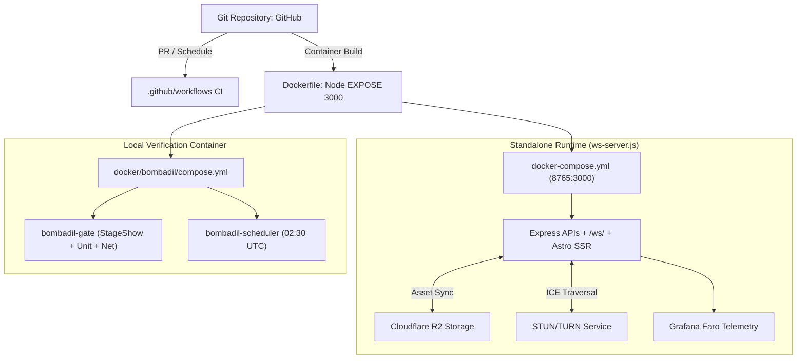

# DevOps, Containers, and CI Infrastructure

| Field | Value |
| --- | --- |
| Audience | Engineers, architects, and QA reviewers consulting capability-level reference architecture |
| BMAD Owner | Architect (`bmad-agent-architect`) and Developer (`bmad-agent-dev`) |
| Classification | Maintained Capability Reference (`DECISIONS.tsv` row 63), distinct from operational quickstarts |
| Operational Guide | [../07-deployment/README.md](../07-deployment/README.md) |
| Deployment Files | [`Dockerfile`](../../Dockerfile), [`docker-compose.yml`](../../docker-compose.yml), [`docker/bombadil/compose.yml`](../../docker/bombadil/compose.yml), [`.github/workflows/playwright-quality.yml`](../../.github/workflows/playwright-quality.yml) |

---

## 1. Overview and Active Infrastructure

`LandingPage` runs in standalone Node (`npm start`), Docker Compose ([`docker-compose.yml`](../../docker-compose.yml)), and the local Linux Chromium verification compose stack ([`docker/bombadil/compose.yml`](../../docker/bombadil/compose.yml)), backed by GitHub Actions CI workflows in `.github/workflows/`. Legacy Kubernetes manifests (`k8s/`), root ArgoCD YAML specs (`argocd-application.yaml`, `argocd-project.yaml`, `argocd-repo-secret.yaml`), `deploy-k8s.yml`, and Grafana metrics collector dumps/scripts were retired in `SPRINT-SLC-00`.

---

## 2. Containerization: [`Dockerfile`](../../Dockerfile) and Compose Stacks

- **Runtime Container ([`Dockerfile`](../../Dockerfile) and [`docker-compose.yml`](../../docker-compose.yml))**:
  - Serves unified HTTP web pages, Astro SSR middleware, REST APIs (`/api/mcard`, `/api/test-runs`, `/api/clm`), and WebSocket `/ws/` signaling on port `3000` (`docker-compose.yml` maps `8765:3000`), with `/health` liveness checks returning `{ status: "ok" }`.
  - Development runs `astro dev` on `4322` alongside `ws-server.js` on `3000`, while isolated Playwright suites bind `TEST_PORT=3001`.
- **Local Verification Compose ([`docker/bombadil/compose.yml`](../../docker/bombadil/compose.yml))**:
  - **`bombadil-gate`**: Executes Astro build, scene `--check`, `stageshow:check-css`, Bombadil net checks, `check:explorable-gui`, `check:net`, `docs:check`, `test:unit`, and strict Linux Chromium `stageshow:sweep --strict`.
  - **`bombadil-scheduler`**: Runs `scripts/bombadil/nightly.sh` daily at `02:30` UTC.

---

## 3. Retired Kubernetes and ArgoCD Assets (`SPRINT-SLC-00`)

Legacy Kubernetes manifests under `k8s/`, root `argocd-*.yaml` definitions, `.github/workflows/deploy-k8s.yml`, and static `.github/workflows/grafana-metrics-*` collector scripts and snapshots were removed in `SPRINT-SLC-00` (`SLC-D02`) because deployment shifted to container runtime packages and local Docker verification. Historical ArgoCD background notes remain archived under `docs/07-deployment/` and `docs/project/` for reference.

---

## 4. Cloudflare R2 Object Storage & Asset CDN

- **S3 API Compatibility**: R2 hosts heavy static assets (videos, 3D models, PDF exports, MCard backups) with edge cache headers (`Cache-Control: public, max-age=31536000, immutable`).

---

## 5. Automated CI/CD and Reporting Workflows

Located in `.github/workflows/`:

1. **Automated Component Battery** ([`clm-test-all-components.yml`](../../.github/workflows/clm-test-all-components.yml)): Executes unit, net, docs, and Playwright integration suites.
2. **Playwright Quality Workflow** ([`playwright-quality.yml`](../../.github/workflows/playwright-quality.yml)): Runs Desktop Chromium and cross-browser smoke verification.
3. **Daily Commit Summaries** ([`daily-commit-summary.yml`](../../.github/workflows/daily-commit-summary.yml)): Aggregates daily repository activity into automated digests.
