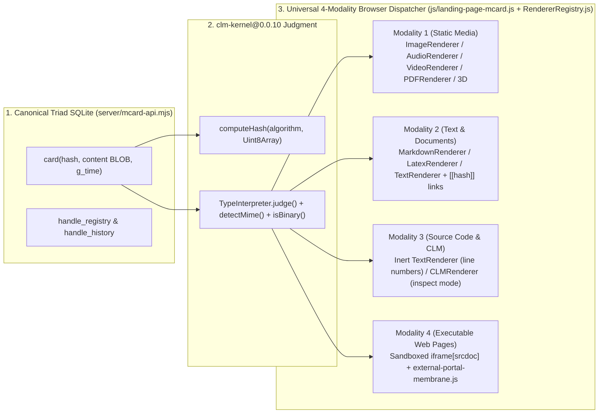

# Program Charter: Submodule Modularity, Universal MCard Content Browser, and Organizational Alignment (`Program SMO`)

> **Status**: Graduated (2026-10-21) (`docs/sprints/01-architecture/`)
> **Program Code**: `SMO` (`SMO-01..SMO-05`)
> **Target Estate**: `LandingPage` (with cross-estate boundary alignment across `MCard_TDD`, `clm`, and `mcard-studio`)
> **Published Kernel Consensus**: `clm-kernel@0.0.10` (published latest on npm, PyPI, and crates.io; workspace development line `0.0.11`)
> **Workbench Counterpart**: `mcard-studio@0.0.3` and `@mcard/studio@0.0.3`
> **Architectural Authority**: [MCard_TDD/README.md](../../../../README.md), [mcard-studio/README.md](../../../../mcard-studio/README.md), [clm/README.md](../../../../clm/README.md)

---

## 1. Executive Thesis and Mission

`LandingPage` serves two complementary roles inside the four-estate `MCard_TDD` workspace.

1. **Universal 4-Modality MCard Content Browser and Sovereign Portal Runtime**. Every piece of content in `LandingPage` is stored, addressed, typed, and browsed as an immutable MCard inside the canonical 3-table SQLite Triad (`card`, `handle_registry`, `handle_history` in [`server/mcard-api.mjs`](../../../server/mcard-api.mjs)), hashed and classified by the published `clm-kernel@0.0.10` package (`computeHash`, `TypeInterpreter`, `detectMime`, `isBinary`), and projected in the browser through a modular, security-bounded renderer and membrane pipeline ([`js/landing-page-mcard.js`](../../../js/landing-page-mcard.js), [`js/renderers/RendererRegistry.js`](../../../js/renderers/RendererRegistry.js), and [`js/external-portal-membrane.js`](../../../js/external-portal-membrane.js)). Whether a card holds a static media file, a structured text document, source code, or an executable web page, the browser resolves its type judgment deterministically and mounts the appropriate viewlet or sandboxed iframe membrane without raw `innerHTML` script injection or unintended code execution.
2. **Device-Sensitive Testing Workbench and Corpus Producer**. `LandingPage` hosts [`responsive-lab.html`](../../../responsive-lab.html), the deterministic 6-sample portal corpus generator ([`scripts/seed-portal-samples.mjs`](../../../scripts/seed-portal-samples.mjs)), the interaction recorder ([`js/harness/recorder.js`](../../../js/harness/recorder.js)), and the Playwright Tier-1 replay driver ([`scripts/playwright-replay-driver.mjs`](../../../scripts/playwright-replay-driver.mjs)). It tests any local or external web surface (including `mcard-studio` at `http://127.0.0.1:5320/`) across cell phone, laptop, desktop, and wearable viewports and mints witnessed `urn:mcard:test_run:*` and `urn:mcard:replay_result:*` MCards.

### 1.1 Codebase Baseline and Identified Gaps

Direct inspection of `LandingPage`, `mcard-studio`, and `clm-kernel@0.0.10` establishes four concrete architectural gaps that `Program SMO` resolves.

1. **Binary payload corruption and ad-hoc MIME sniffing in [`server/mcard-api.mjs`](../../../server/mcard-api.mjs)**. `CanonicalTriadBackend.get(hash)` currently decodes `row.content` unconditionally as UTF-8 (`row.content.toString('utf8')`) before calling `verifyRecord`, and `detectContentType(content)` uses a 15-line regex that recognizes only six MIME strings (`application/octet-stream`, `text/html`, `application/xml`, `application/json`, `text/markdown`, `text/plain`). Binary static media MCards (`image/png`, `audio/mpeg`, `video/mp4`, `application/pdf`, `model/gltf-binary`) lose byte fidelity when round-tripped through UTF-8 decoding, and `clm-kernel@0.0.10`'s 48-type `TypeInterpreter` and `detectMime` are not yet wired into `server/mcard-api.mjs`.
2. **Bypassed renderer registry and unsandboxed HTML injection in [`js/landing-page-mcard.js`](../../../js/landing-page-mcard.js) and [`js/renderers/EmbedRenderer.js`](../../../js/renderers/EmbedRenderer.js)**. `renderPage(card)` in `js/landing-page-mcard.js` currently checks only `contentType === 'text/html' ? card.content : '<pre>...</pre>'`. That implementation bypasses `js/renderers/RendererRegistry.js` (`ImageRenderer`, `AudioRenderer`, `VideoRenderer`, `PDFRenderer`, `MarkdownRenderer`, `LatexRenderer`, `TextRenderer`, `CLMRenderer`, `EmbedRenderer`), injects `text/html` directly into the host DOM without an iframe sandbox, and leaves `EmbedRenderer.js` rendering an `<iframe>` without `sandbox` attributes.
3. **Published latest `clm-kernel` (`0.0.10`) consensus enforcement**. The latest published `clm-kernel` across npm, PyPI, and crates.io is `0.0.10` (while in-tree `clm` manifests advance on `workspace_version: "0.0.11"`). Both consumer submodules (`mcard-studio` and `LandingPage`) and `mcard-studio/scripts/check-kernel-version-consensus.mjs` must enforce exact-pin parity to the latest published `clm-kernel` version (`0.0.10`) at all times, including live registry checks against `https://registry.npmjs.org/clm-kernel/latest`.
4. **Documentation sprawl in `LandingPage/docs/` and `LandingPage/README.md`**. Over a dozen loose root markdown files (`CHESS_GAME_DOCUMENTATION.md`, `MCARD_LIBRARY_STRATEGY.md`, `ZITADEL_INTEGRATION_GUIDE.md`, etc.) sit outside the numbered `00-getting-started/` through `11-standards/` hierarchy, and `LandingPage/README.md` does not yet document the Universal 4-Modality MCard Content Browser architecture or the `clm-kernel@0.0.10` / `mcard-studio@0.0.3` contracts.

---

## 2. Universal 4-Modality MCard Content Browser Architecture

To enable a generalizable solution that browses all content as MCard while fitting the current codebase across `clm-kernel@0.0.10`, `@mcard/studio@0.0.3`, and `LandingPage`, `Program SMO` standardizes four content modalities over one canonical Triad record law.

| Modality | Representative MIME Types & Extensions | Storage & API Contract (`server/mcard-api.mjs`) | Browser Projection & Security Contract (`LandingPage` & `mcard-studio`) |
|:---|:---|:---|:---|
| **1. Static Media Files** | `image/png`, `image/jpeg`, `image/webp`, `image/svg+xml`, `audio/mpeg`, `audio/wav`, `audio/ogg`, `video/mp4`, `video/webm`, `application/pdf`, `model/gltf-binary` (`.glb`, `.stl`, `.obj`) | Raw `Buffer` stored in `card.content`; verified as raw bytes before decoding; streamed via `GET /api/mcard/:hash/raw` with `X-Content-Type-Options: nosniff` or base64 payload | Rendered by `ImageRenderer`, `AudioRenderer`, `VideoRenderer`, `PDFRenderer` (`LandingPage`) and `ImageViewlet`, `Spatial3dViewlet` (`@mcard/studio/viewlets`). Zero script execution (`svg+xml` rendered via `` or sanitized container). |
| **2. Text & Structured Documents** | `text/markdown` (`.md`), `text/plain` (`.txt`), `application/json` (`.json`), `application/x-yaml` (`.yaml`, `.yml`), `application/x-latex` (`.tex`) | UTF-8 bytes stored in `card.content`; judged by `TypeInterpreter` (`category: 'document' \| 'text' \| 'data'`) | Rendered by `MarkdownRenderer`, `LatexRenderer`, `TextRenderer` (`LandingPage`) and `MarkdownViewlet` (`@mcard/studio/viewlets`). HTML-escaped/sanitized output with `[[hash]]` and `[[handle\|label]]` transclusion resolution. |
| **3. Source Code & CLM Descriptors** | `text/javascript` (`.js`, `.mjs`), `text/x-typescript` (`.ts`, `.tsx`), `text/x-python` (`.py`), `text/rust` (`.rs`), `text/css` (`.css`), `application/sql` (`.sql`), `application/clm` (`.clm`), plus `.html` in `source` view mode | Immutable UTF-8 source stored in `card.content`; judged as `category: 'code'` or `semanticStratum: 'process' \| 'proof'` | **Inert Inspection Law (`INV-ULR-07` / `ULR-08`)**. Rendered by `TextRenderer` with `lineNumbers: true` or `CLMRenderer` in structural inspect mode (`LandingPage`) and `MonacoTextViewlet` / `inspectPublishedDescriptor` (`mcard-studio`). Browsing source code never evaluates or executes it. |
| **4. Executable Web Pages & Portals** | `text/html` (`.html`, inline single-page MCard), `text/uri-list` (`.url`, external/local portal URLs), `application/x-webapp` | Inline HTML stored in `card.content` or external URL validated via `validateExternalUrl` and probed via SSRF-guarded `GET /api/mcard/probe-url` with pinned fallback snapshot card | **Sandboxed Membrane Law (`INV-ULR-05` / `SMR-09`)**. Never injected via raw `host.innerHTML`. Inline HTML renders inside `<iframe sandbox="allow-scripts allow-forms" referrerpolicy="no-referrer" srcdoc="...">` (with optional toggle to inert source view). External URLs resolve through `external-portal-membrane.js` (`live` sandboxed frame, `snapshot` Sovereign Gateway Card, or `offline` CAS snapshot), matching `WebappCanvas` in `mcard-studio`. |

---

## 3. Program Invariants (`INV-SMO-01` .. `INV-SMO-05`)

- **`INV-SMO-01` (Submodule Sovereignty and Standalone Execution)**. `LandingPage` builds, boots (`npm run dev`), and passes its unit (`npm run test:unit`) and single-page MCard verification suites (`node --test tests/single-page-mcard.test.mjs`) whether cloned standalone or mounted as a Git submodule under `MCard_TDD/LandingPage`. Zero runtime or test imports may traverse `../clm` or `../mcard-studio` filesystem paths.
- **`INV-SMO-02` (Published Latest `clm-kernel` Consensus)**. Both consumer submodules (`LandingPage` and `mcard-studio`) must always exact-pin the latest published `clm-kernel` version (`0.0.10`) in `package.json`, `package-lock.json`, `node_modules/clm-kernel/package.json`, and `mcard-studio/scripts/config/kernel-version-consensus.json`, verified against `https://registry.npmjs.org/clm-kernel/latest` by `mcard-studio/scripts/check-kernel-version-consensus.mjs`. Zero local SHA-256/Blake3 re-implementations are permitted in `LandingPage`.
- **`INV-SMO-03` (Universal 4-Modality MCard Content Browser Contract)**. `CanonicalTriadBackend` in `LandingPage/server/mcard-api.mjs` must verify digests over raw bytes (`Buffer` / `Uint8Array`) before any text decoding, classify content via `clm-kernel@0.0.10`'s `TypeInterpreter` and `detectMime` across all four modalities (`media`, `document`, `code`, `webapp`), and stream binary payloads without UTF-8 corruption via `GET /api/mcard/:hash/raw`.
- **`INV-SMO-04` (Sandboxed Executable Membrane and Inert Code Inspection)**. `LandingPage/js/landing-page-mcard.js` and `LandingPage/js/renderers/EmbedRenderer.js` must never inject raw `text/html` into the parent DOM via unsandboxed `innerHTML` or mount unsandboxed `<iframe>` elements. Executable HTML/webapp MCards must mount inside a sandboxed iframe (`sandbox="allow-scripts allow-forms"` omitting `allow-same-origin` by default), and source-code MCards must render as inert syntax-escaped text with zero script evaluation.
- **`INV-SMO-05` (Documentation Hygiene and Contract D Modularity)**. All documentation in `LandingPage/docs/` must reside in the numbered `00-getting-started/` through `11-standards/` tiers or `docs/archive/` (except `README.md`, `INDEX.md`, `STATUS.md`, and `bmm-workflow-status.yaml`), with 100% link resolution and every modified JS/MJS module remaining within Contract D (`<= 500` LOC).

---

## 4. Sprint Architecture and Execution Sequence

| Sprint | Specification File | Primary Focus & Deliverables | Key Verification Gate |
|:---|:---|:---|:---|
| **SMO-01** | [`sprint-smo01-submodule-topology-and-monorepo-duality.md`](./sprint-smo01-submodule-topology-and-monorepo-duality.md) | Standalone submodule vs `MCard_TDD` monorepo duality, `Makefile` target alignment, and **binary-safe `CanonicalTriadBackend` byte verification + `GET /api/mcard/:hash/raw`** in `server/mcard-api.mjs` | `node --test tests/single-page-mcard.test.mjs && npm run test:unit` |
| **SMO-02** | [`sprint-smo02-published-kernel-consensus-and-dependency-parity.md`](./sprint-smo02-published-kernel-consensus-and-dependency-parity.md) | **Published latest `clm-kernel@0.0.10` consensus** across `LandingPage` and `mcard-studio` (live npm registry check) and **`TypeInterpreter` / `detectMime` 4-modality classification** in `server/mcard-api.mjs` | `node ../mcard-studio/scripts/check-kernel-version-consensus.mjs` |
| **SMO-03** | [`sprint-smo03-four-estate-cross-boundary-contracts.md`](./sprint-smo03-four-estate-cross-boundary-contracts.md) | **Universal 4-Modality MCard Content Browser dispatcher** in `js/landing-page-mcard.js` + `RendererRegistry.js` + `EmbedRenderer.js` + `external-portal-membrane.js`, 4-modality sample corpus in `scripts/seed-portal-samples.mjs`, and `:5320` workbench contract | `node scripts/seed-portal-samples.mjs && node --test tests/single-page-mcard.test.mjs` |
| **SMO-04** | [`sprint-smo04-documentation-hygiene-and-tier-reorganization.md`](./sprint-smo04-documentation-hygiene-and-tier-reorganization.md) | Reorganize loose `LandingPage/docs/` root files into numbered tiers (`01-architecture/`..`11-standards/` + `archive/`), author `UNIVERSAL_MCARD_BROWSER_ARCHITECTURE.md`, and refresh `docs/INDEX.md` | Zero loose root docs; 100% markdown link resolution |
| **SMO-05** | [`sprint-smo05-master-readme-alignment-and-verification.md`](./sprint-smo05-master-readme-alignment-and-verification.md) | Rewrite `LandingPage/README.md` for the Universal 4-Modality MCard Content Browser + Responsive Testing Workbench, and execute full-program verification across all 4 estates | Full `SMO-01..SMO-05` gate suite green |

---

## 5. Cross-Estate Alignment Matrix

| Estate | Role in Universal MCard Content Browsing | Governing Contract with `LandingPage` |
|:---|:---|:---|
| **`clm` (`clm-kernel@0.0.10`)** | Constitutional producer of content-addressed hashing (`computeHash`), 48-type deterministic judgment (`TypeInterpreter`, `detectMime`, `isBinary`), and Universe stratification (`U0..U3`). | `LandingPage` consumes `clm-kernel@0.0.10` exclusively from npm (`INV-SMO-02`). Workspace development in `clm` advances on `0.0.11`, while `consensus_version` tracks published `0.0.10`. |
| **`mcard-studio` (`0.0.3` / `@mcard/studio@0.0.3`)** | Flagship polymorphic workbench (`:5320`) and viewlet library (`@mcard/studio/type`, `@mcard/studio/viewlets`). | Shares the 3-table Triad SQLite schema (`card`, `handle_registry`, `handle_history`), the 4-modality viewlet/membrane taxonomy, the `?card=<hash>&handle=<handle>` deep link, and `portal_samples_manifest.yaml` (`ResponsiveViewportLabViewlet`). |
| **`MCard_TDD` (Parent Orchestrator)** | Canonical SQLite DDL authority (`schema/mcard_schema.sql`), cross-repo test harness (`tests/cross_repo/`), and root `Makefile` orchestrator. | Orchestrates `LandingPage`, `mcard-studio`, and `clm` via root `Makefile` targets without coupling submodule runtime imports. |

---

## 6. Program-Level Definition of Done Checklist

- [x] **DoD-SMO-00-01 (Binary-Safe Triad Storage & Raw Media Streaming)**: `CanonicalTriadBackend` in `LandingPage/server/mcard-api.mjs` verifies digests over raw bytes before UTF-8 decoding and serves binary MCards via `GET /api/mcard/:hash/raw` with `X-Content-Type-Options: nosniff`.
- [x] **DoD-SMO-00-02 (Published Latest `clm-kernel@0.0.10` Consensus)**: `LandingPage` and `mcard-studio` exact-pin `clm-kernel@0.0.10` across all manifests, lockfiles, installed `node_modules`, and `kernel-version-consensus.json`, passing `check-kernel-version-consensus.mjs` against the live npm registry.
- [x] **DoD-SMO-00-03 (Universal 4-Modality MCard Browser Projection)**: `LandingPage` classifies and renders Static Media, Text/Structured Documents, Inert Source Code, and Sandboxed Executable Web Pages (`iframe[sandbox="allow-scripts allow-forms"]`) as MCards with zero raw `innerHTML` script execution.
- [x] **DoD-SMO-00-04 (4-Modality Sample Corpus & Cross-Estate Interop)**: `scripts/seed-portal-samples.mjs` seeds deterministic samples covering all four modalities and passes `verify()`, while `responsive-lab.html` and `mcard-studio` (`:5320`) interoperate cleanly.
- [x] **DoD-SMO-00-05 (Documentation Hygiene & Master README Alignment)**: `LandingPage/docs/` has zero unindexed root sprawl, `docs/INDEX.md` and `LandingPage/README.md` are 100% link-verified, and all modified modules obey Contract D (`<= 500` LOC).
