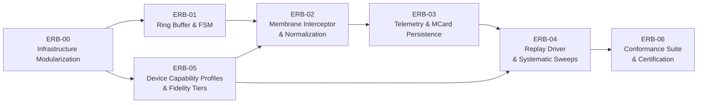

# Active Sprint Series ERB: Device-Sensitive Test Infrastructure

> Responsive Lab → Event Capture → MCard Test Data → Playwright Replay → Device Conformance & Certification

> **Merge note (41cc6a1).** Two refinements of this series were written in parallel and are merged here. From Yohanes's version: the `js/harness/` module home, `target-membrane.js`, `lab-toolbar.js`, `membrane-interceptor.js`, `telemetry-collector.js`, live tap ergonomics, the sweep spec name and `npm run test:responsive`, the replay speed and slow-motion modes, invariants `INV-INF-01` and `INV-DEV-01..04`, the certification record, and the [Device-Sensitive Testing Infrastructure Guide](../../08-testing/DEVICE_SENSITIVE_TESTING_INFRASTRUCTURE.md). From the code-verified version: the fidelity tiers, the cross-origin probe agent, the dedicated `/api/test-runs` router with its own body limit, the registry-derived device matrix, and the conformance catalog. His ERB-05 (sweeps and certification) is split between ERB-04 and ERB-06; the ERB-05 number now holds device capability profiles.

## Executive Summary

This series turns LandingPage into **infrastructure for testing device-sensitive functionality** of one chosen web target (for example `http://localhost:4321/`, `app.html`, or a staging URL).

"Device-sensitive" means behaviour that changes with the device: viewport geometry, orientation, pixel density, input modality (touch, coarse pointer, no hover), user-agent and mobile flags, user-preference media features, safe-area insets, sensors and permissions, and network or CPU limits.

The series delivers five capabilities, in order:

1. A **refactored Responsive UI Lab** whose stage, target binding, and test API are testable ESM modules (`SPRINT-ERB-00`).
2. A **bounded event ring buffer** and recording state machine (`SPRINT-ERB-01`).
3. **Device capability profiles** and an explicit **fidelity tier** for every run (`SPRINT-ERB-05`).
4. **Capture membranes** for same-origin and cross-origin targets, with scale-free normalization and live tap-target ergonomics (`SPRINT-ERB-02`).
5. **In-target device telemetry** (overflow, frame timing, layout shift) and **MCard test-run persistence** via `clm-kernel` (v0.0.9), **Playwright replay and systematic sweeps**, and a **declarative device-conformance suite** with regression history and responsive certification (`SPRINT-ERB-03`, `-04`, `-06`).

The work runs under the **BMAD (BMM) multi-agent framework** with **pstack (`poteto-mode`)** engineering rigor.

> [!IMPORTANT]
> All sprints are in `SPECIFICATION`. README and functional-spec statements about ring-buffer capture, MCard test datasets, and replay describe **planned** capabilities until the matching sprint is sealed.

**Guide:** [`docs/08-testing/DEVICE_SENSITIVE_TESTING_INFRASTRUCTURE.md`](../../08-testing/DEVICE_SENSITIVE_TESTING_INFRASTRUCTURE.md) is the user-facing guide for this series. ERB-04 and ERB-06 extend it.

---

## 1. Device-Sensitive Dimensions and Fidelity Tiers

A browser iframe can only emulate the CSS viewport. Every other device dimension needs a more capable runner. Each recorded run therefore declares its tier, so nobody mistakes a viewport-only test for a device test (`INV-DSF-01`).

| Dimension | T0 Lab iframe | T1 Playwright context | T2 Playwright + CDP | T3 Real device (LAN) |
| :--- | :---: | :---: | :---: | :---: |
| Viewport width × height, rotation | ✅ | ✅ | ✅ | ✅ |
| `devicePixelRatio`, `srcset` choice | ❌ | ✅ `deviceScaleFactor` | ✅ | ✅ |
| Touch events, `pointer: coarse`, `hover: none` | ❌ | ✅ `hasTouch` + `isMobile` | ✅ | ✅ |
| User agent, `<meta viewport>` handling | ❌ | ✅ `userAgent` + `isMobile` | ✅ | ✅ |
| `prefers-color-scheme`, `prefers-reduced-motion` | ❌ | ✅ `emulateMedia` | ✅ | ✅ |
| Locale, timezone, geolocation, permissions | ❌ | ✅ | ✅ | ✅ |
| `screen.orientation` / `orientationchange` event | ❌ | ⚠️ size only | ⚠️ size only | ✅ |
| CPU and network throttling | ❌ | ❌ | ✅ | ✅ |
| Safe-area insets (`env(safe-area-inset-*)`) | ❌ | ❌ | ❌ | ✅ |
| Device-orientation and motion sensors | ❌ | ❌ | ⚠️ Chromium only | ✅ |

- **T0** is for visual, interactive exploration and human-driven recording.
- **T1–T2** is for automated replay, sweeps, and conformance.
- **T3** is ground truth. Its interface is specified in ERB-05; implementation is an optional track in ERB-06.

### 1.1 Device-Sensitive Functionalities Under Test

| Functionality | Invariant | Check (ERB-06) | Measured by | Lowest tier |
| :--- | :--- | :--- | :--- | :---: |
| Orientation reflow without clipping | `INV-RVP-01`, `INV-DEV-03` | `orientation-preserves-state` | Sweep + replay | T0 |
| No horizontal viewport bleed | `INV-DEV-01` | `no-horizontal-overflow` | `telemetry-collector.js` (ERB-03), sweep | T0 |
| Touch-target ergonomics (≥ 44 px) | `INV-DEV-02` | `tap-target-size` | Live ribbon indicator (ERB-02), conformance | T1 (coarse pointer) |
| Frame budget during interaction | `INV-DEV-04` | `frame-budget` (advisory) | `telemetry-collector.js`, `paced` replay | T1 |
| Layout stability (CLS) | — | `layout-stability` | `telemetry-collector.js` | T1 |
| Breakpoints, DPR assets, reduced motion, colour scheme, hover-to-touch paths | — | catalog checks | Conformance | T1 |
| Safe-area insets, real `screen.orientation` | — | `safe-area-insets` | T3 probe agent | T3 |

---

## 2. Baseline vs. Gap (verified against `main` @ `6f9a53a`)

| Area | What exists today | Gap this series closes |
| :--- | :--- | :--- |
| `responsive-lab.html` | 1405 lines; ~470-line inline `<script type="module">` (L932–1405). Three places decide the loaded target: the static `src="app.html"` attribute, the boot `?target=` writer (L1365), and the **Load Target** writer (L1346). Pop-out (L1352) reads the selector on its own. 8 `window.__*` globals (L1394–1401). | ERB-00 extracts modules, gives `iframe.src` a single writer, and consolidates the test API. |
| Target list | Duplicated: `<select id="public-site-selector">` options **and** the `ws-server.js` CORS `origin` array. | ERB-00 makes `app-config.json → labTargets` the single target registry (`INV-STU-02`). |
| `js/device-registry.js` | 8 built-ins with `width`, `height`, `pixelRatio`. Storage key `pkc_responsive_lab_devices_v1`. No touch, mobile, pointer, or hover fields. | ERB-05 adds capability schema v2 with a non-destructive migration. |
| `js/external-portal-membrane.js` | `validatePortalTelemetryMessage` / `createTelemetryReceiver` already check `event.source`, nonce, origin, and type. `assertSafeUrl` validates URLs. Schema is hardcoded to `mcard-portal-telemetry/v1`. | ERB-02 parameterizes the schema and **reuses** the receiver for cross-origin capture. ERB-00 reuses `assertSafeUrl`. |
| `server/mcard-api.mjs` | `CanonicalTriadBackend` (`put`, `bindHandle`, `handleHistory`), `hashContent` via `clm-kernel` `computeHash`, `formatGTime`. Router mounted at `/api/mcard` with a `/:hash` catch-all. | ERB-03 adds a dedicated `/api/test-runs` router that shares the backend instance. |
| `ws-server.js` | Global `app.use(express.json())` (100 KB default) at L46 runs **before** route mounts. | ERB-03 mounts the test-run router with its own 2 MB parser **before** the global parser. |
| Tests | `tests/features/responsive-rotation-and-devices.spec.js` (RVP-T01…, 30 passing). `node:test` files live ad hoc (`tests/*.test.mjs`, `tests/observability/*.test.js`). No `tests/unit/`, no `test:unit` script. `features` project has `retries: 2`. | ERB-00 adds `tests/unit/` and `npm run test:unit`. Replay and conformance specs pin `retries: 0`. |

---

## 3. Execution Order

Sprint codes are stable identifiers. Execution order follows the dependency graph, not the numbers.



| Order | Sprint | Title | Status | Primary artifacts | Verification gate |
| :---: | :--- | :--- | :--- | :--- | :--- |
| 1 | **[ERB-00](./SPRINT-ERB-00-infrastructure-refactoring.md)** | Infrastructure Modularization & Lab Refactor Baseline | 🟡 SPECIFICATION | `js/harness/viewport-stage.js`, `target-membrane.js`, `lab-toolbar.js`, `app-config.json#labTargets` | `npm run test:unit` + RVP suite green after **every** step |
| 2a | **[ERB-01](./SPRINT-ERB-01-ring-buffer-core.md)** | Ring Buffer Core & Recording FSM | 🟡 SPECIFICATION | `js/harness/event-ring-buffer.js`, `recording-state-machine.js` | `node --test tests/unit/event-ring-buffer.test.mjs tests/unit/recording-state-machine.test.mjs` |
| 2b | **[ERB-05](./SPRINT-ERB-05-device-capability-profiles.md)** | Device Capability Profiles & Fidelity Tiers | 🟡 SPECIFICATION | `js/device-registry.js` (schema v2), `js/harness/fidelity.js`, `tests/fixtures/device-matrix.js` | `node --test tests/unit/device-registry-v2.test.mjs tests/unit/fidelity.test.mjs` |
| 3 | **[ERB-02](./SPRINT-ERB-02-membrane-normalization.md)** | Target Membrane Interceptor, Touch Ergonomics & Normalization | 🟡 SPECIFICATION | `js/harness/membrane-interceptor.js`, `capture-*.js`, `lab-probe-agent.js`, `normalize-event.js` | `npx playwright test tests/features/responsive-capture.spec.js --project=features` |
| 4 | **[ERB-03](./SPRINT-ERB-03-mcard-clm-persistence.md)** | Device Telemetry Collector & MCard Test-Run Persistence | 🟡 SPECIFICATION | `js/harness/telemetry-collector.js`, `server/test-run-api.mjs`, `js/harness/test-run-schema.js` | `node --test tests/unit/test-run-api.test.mjs` |
| 5 | **[ERB-04](./SPRINT-ERB-04-playwright-deterministic-replay.md)** | Playwright Replay Driver & Systematic Sweeps | 🟡 SPECIFICATION | `scripts/playwright-replay-driver.mjs`, `tests/features/responsive-replay.spec.js`, `tests/features/systematic-landing-test.spec.js` | `TARGET_URL=… npm run test:responsive` and `npm run test:replay` |
| 6 | **[ERB-06](./SPRINT-ERB-06-device-sensitive-conformance.md)** | Conformance Suite & Certification | 🟡 SPECIFICATION | `tests/conformance/checks/*.js`, `tests/conformance/*.conformance.json`, `tests/features/device-conformance.spec.js`, `urn:mcard:certification:responsive:v1` | `TARGET_URL=… npx playwright test tests/features/device-conformance.spec.js --project=features` |

---

## 4. Master Refactoring Sequence

Every refactoring step is behaviour-preserving unless marked **(behaviour change)**. Each step must leave both gates green before the next step starts:

```bash
npm run test:unit
npx playwright test tests/features/responsive-rotation-and-devices.spec.js --project=features
```

| # | Step | Sprint | Kind | Removes / replaces |
| :---: | :--- | :--- | :--- | :--- |
| 1 | `ERB-00/R0` Characterize `?target=` boot (new RVP-T11, RVP-T12) | ERB-00 | Test-only | Untested boot path from `6f9a53a` |
| 2 | `ERB-00/R1` Extract pure geometry → `viewport-geometry.js` | ERB-00 | Extract | Inline `computeScale` / rotate math |
| 3 | `ERB-00/R2` Extract stage binding → `viewport-stage.js`; emit `lab:viewport-change` | ERB-00 | Extract | Inline CSS-variable writes and `ResizeObserver` |
| 4 | `ERB-00/R3` Single writer of `iframe.src` → `target-membrane.js` (reuses `assertSafeUrl`) | ERB-00 | Consolidate | Static `src`, 2 inline `iframe.src =` writers, independent pop-out read |
| 5 | `ERB-00/R4` Single target registry `app-config.json#labTargets` | ERB-00 | Consolidate | Hardcoded `<option>`s and CORS array entries |
| 6 | `ERB-00/R5` Extract presets/manager UI → `device-presets-ui.js` | ERB-00 | Extract | Inline `renderPresets` / manager modal |
| 7 | `ERB-00/R6` `window.__lab` namespace; migrate callers; delete legacy globals | ERB-00 | Migrate + delete | 8 `window.__*` globals |
| 8 | `ERB-00/R7` `tests/unit/` + `npm run test:unit` | ERB-00 | Harness | — |
| 9 | `ERB-05/R1` Registry schema v2 + v1→v2 migration (v1 key kept for rollback) | ERB-05 | Extend | — |
| 10 | `ERB-05/R2` `tests/fixtures/device-matrix.js` derived from `BUILTIN_DEVICES` | ERB-05 | Consolidate | Hardcoded device dimensions in specs |
| 11 | `ERB-02/R1` Parameterize `validatePortalTelemetryMessage` schema (default unchanged) | ERB-02 | Generalize | Hardcoded `TELEMETRY_SCHEMA_VERSION` check |
| 12 | `ERB-02/R2` Recorder subscribes to `lab:viewport-change` (no new geometry code) | ERB-02 | Wire | — |
| 13 | `ERB-03/R1` `initMCardAPI` exposes its `CanonicalTriadBackend` instance | ERB-03 | Expose | Risk of a second `DatabaseSync` handle |
| 14 | `ERB-03/R2` Add `CanonicalTriadBackend.listHandles(prefix)` | ERB-03 | Extend | Ad-hoc SQL in routers |
| 15 | `ERB-03/R3` Mount `/api/test-runs` with 2 MB parser before global `express.json()` | ERB-03 | Reorder **(behaviour change)** | 413 on large sessions |
| 16 | `ERB-04/R1` Migrate RVP spec hardcoded device dims to `device-matrix.js` | ERB-04 | Migrate | Duplicated device numbers |
| 17 | `ERB-06/R1` Lift sweep assertions into the conformance check catalog | ERB-06 | Extract | Inline asserts in `systematic-landing-test.spec.js` |
| 18 | `ERB-06/R2` `systematic-landing-test.spec.js` becomes "conformance with default spec"; delete duplicates | ERB-06 | Migrate + delete | Duplicated assertion code |

Steps that only **add** new modules (for example `membrane-interceptor.js` in ERB-02, `telemetry-collector.js` in ERB-03/R5, the replay driver in ERB-04, the certification roll-up in ERB-06/R8) are listed in their own sprint and not repeated here.

---

## 5. Invariants Enforced Across the Series

| ID | Name | Rule | Introduced |
| :--- | :--- | :--- | :--- |
| `INV-RVP-01` | Dynamic 2D geometry & rotation | Rotation swaps width and height; twice is identity. | EPIC-RVP (existing) |
| `INV-RVP-02` | Layout-box containment | `s = min(1, W_avail / w, H_avail / h)`; never upscales. | EPIC-RVP (existing) |
| `INV-STU-01` | Single target focus | Exactly one module writes `iframe.src`; capture, replay, and conformance bind to one explicit target. | ERB-00 (structural) |
| `INV-STU-02` | Single target registry | Target URLs and allowed origins are declared once in `app-config.json#labTargets`. | ERB-00 |
| `INV-ERB-01` | Bounded footprint | Fixed slot array, capacity `1 ≤ N ≤ 2048`, O(1) push, no buffer growth, overwrites counted. | ERB-01 |
| `INV-ERB-02` | Scale-independent coordinates | `nx, ny ∈ [0, 1]` computed in the **child** document's layout viewport, independent of stage scale `s`. | ERB-02 |
| `INV-ERB-03` | State machine determinism | `IDLE → RECORDING ⇄ PAUSED → FINALIZED → IDLE`; invalid transitions throw. | ERB-01 |
| `INV-ERB-04` | Canonical serialization | Identical runs serialize to identical bytes (sorted keys, fixed float precision), so they produce identical hashes. | ERB-03 |
| `INV-ERB-05` | Origin-checked membrane | Cross-origin capture accepts a message only if source, origin (from `labTargets`), nonce, schema, and type all match. Rejections are counted, never silent. | ERB-02 |
| `INV-DSF-01` | Declared fidelity | Every run and report records `fidelity.tier`, `emulated[]`, and `notEmulated[]`. A check that needs a higher tier is reported `skipped: fidelity`, never passed. | ERB-05 |
| `INV-DSF-02` | Single device source of truth | Lab presets, Playwright contexts, and conformance predicates all derive from `js/device-registry.js`. | ERB-05 |
| `INV-PRV-01` | Capture privacy | No raw keystrokes. Values of `password`, `cc-*`, `one-time-code`, and `[data-lab-redact]` inputs are replaced with `"<redacted>"`. | ERB-02 |
| `INV-INF-01` | Refactor parity | Infrastructure refactors never change what a test asserts. ERB-00/R6 may change only how tests reach the lab (accessors), never the assertions or their pass counts. | ERB-00 |
| `INV-DEV-01` | No horizontal bleed | `document.documentElement.scrollWidth ≤ window.innerWidth` on every device and orientation. | ERB-03 (measured), ERB-06 (enforced) |
| `INV-DEV-02` | Touch-target size | Interactive elements on coarse-pointer devices are ≥ 44 × 44 CSS px by default; a spec may lower the floor to 24 (WCAG AA). | ERB-02 (live), ERB-06 (enforced) |
| `INV-DEV-03` | Orientation parity | A portrait ↔ landscape swap keeps form state and keeps `INV-DEV-01`. | ERB-06 |
| `INV-DEV-04` | Frame budget | Average frame time ≤ 20 ms against a 16.6 ms (60 fps) budget during listed interactions. Advisory by default. | ERB-03 (measured), ERB-06 (advisory check) |

---

## 6. BMAD Agent Roster & pstack Playbooks

Persona names match the installed BMAD skills (`bmad-agent-*`).

| BMAD role | Persona | Primary responsibility | pstack skills |
| :--- | :--- | :--- | :--- |
| **Architect** | Winston | Module boundaries, invariants, membrane protocol, fidelity model | `architect`, `principle-model-the-domain`, `principle-boundary-discipline` |
| **Dev** | Amelia | Refactor steps and modules, server router | `tdd`, `principle-laziness-protocol`, `principle-migrate-callers-then-delete-legacy-apis` |
| **TEA** | Murat | Characterization tests, unit suites, Playwright replay/sweep/conformance | `tdd`, `principle-test-behavior-not-implementation`, `principle-prove-it-works` |
| **Analyst** | Mary | Device-sensitive requirement catalog, schemas, acceptance criteria | `principle-boundary-discipline`, `principle-type-system-discipline` |
| **UX Designer** | Sally | Recording ribbon, fidelity badge, conformance panel | `principle-experience-first` |
| **SM** | Bob | Step sequencing, DoD sealing, sprint transitions | `principle-sequence-verifiable-units` |
| **Tech Writer** | Paige | Testing guide, functional spec, changelog | `technical-writing`, `unslop` |

---

## 7. Cross-Sprint Conventions

- **Module home**: new browser modules live in `js/harness/`. They are zero-dependency ESM and must import in both the browser and Node (`node:test`) when they hold no DOM code.
- **Unit tests**: `tests/unit/*.test.mjs` with `node:test` + `node:assert/strict`, run by `npm run test:unit`. Playwright's `testMatch: '**/*.spec.js'` already excludes them.
- **Browser tests**: `tests/features/*.spec.js` (`features` project). Replay and conformance specs call `test.describe.configure({ retries: 0 })`, because retries would hide nondeterminism.
- **External targets**: Playwright's `webServer` only starts `:3001`. Specs that use `TARGET_URL` preflight it with `request.get()` and call `test.skip()` with a clear reason when it is unreachable.
- **Test databases**: unit tests use a temp SQLite file under `os.tmpdir()`. They never touch `data/mcard-api.db`.
- **DoD markers**: `vcard:sprint-erb-NN:<snake_case_outcome>`, checked only after the stated command passes against the real artifact.

## 8. Known Constraints & Gotchas

- `index.html` is a test subject inside the lab iframe (RVP-T06). Its redirect must keep the `window.self === window.top` guard. Do not use `<meta http-equiv="refresh">`.
- RVP-T06 depends on `index.html .container { min-height: 1180px; }` to stay scrollable at 832×1133.
- `localhost` and `127.0.0.1` are **different origins**. ERB-02 uses this to get a cross-origin fixture from the single `:3001` server.
- The built-in IDE browser subagent cannot download Playwright binaries. Run headed tests locally (`npm run test:headed`).
