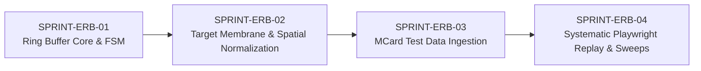

# Active Sprint Series: Single-Target Responsive Workbench, Event Ring Buffer & Playwright Replay

## Executive Summary
This sprint series specifies, aligns, and tracks the implementation of a dedicated **Single-Target Responsive Benchmarking & Telemetry Workbench** for a chosen LandingPage URL (e.g., `http://localhost:4321/` or configured staging target).

Instead of ad-hoc manual testing across scattered pages, this system enables **systematic multi-device test execution, in-memory event capture, and structured test data collection** into immutable MCard records via `clm-kernel` (v0.0.9), verified by a deterministic **Playwright replay engine**.

This work is executed using the **BMAD (BMM) Multi-Agent Framework** orchestrated under **`poteto-mode` (pstack)** engineering rigor.

---

## 🎯 The Single-Target Architecture
- **Target URL Parameterization**: The Responsive UI Lab (`responsive-lab.html`) ingests a single target URL via `?target=<URL>` (defaulting to the chosen LandingPage, e.g. `http://localhost:4321/` or `app.html`).
- **Systematic Device Sweeping**: Standard test sweeps cycle through 8 declarative device profiles (Phone, Tablet, Desktop) in both Portrait and Landscape orientations without geometry distortion (`INV-RVP-01`).
- **Event Ring Buffer**: An in-memory, bounded circular buffer (`INV-ERB-01`) intercepts interaction streams from the chosen target, normalizing coordinates ($nx, ny \in [0.0, 1.0]$) to eliminate stage CSS scale factor bias (`INV-ERB-02`).
- **MCard Test Dataset Ingestion**: Finalized test sessions are packaged into schema-compliant records (`urn:mcard:schema:responsive_test_run:v1`), hashed cryptographically via `clm-kernel` (`blake3`), and stored in SQLite Triad (`data/mcard-api.db`).
- **Playwright Automated Replay**: A headless runner consumes the MCard test artifact to reproduce the test run against the chosen LandingPage target, verifying state and visual parity.

---

## BMAD Agent Roster & RACI Matrix

| BMAD Role | Agent Persona | Primary Responsibility | pstack Focus |
| :--- | :--- | :--- | :--- |
| **Architect** | Winston | Data models, ring buffer pointer math, state machine invariants (`INV-ERB-01..03`), Single Target URL architecture | `principle-model-the-domain`, `architect` |
| **Dev** | Amelia | Core modules (`js/event-ring-buffer.js`, `js/recording-controller.js`, `responsive-lab.html` ?target binding) | `tdd`, `principle-laziness-protocol` |
| **TEA** | Murat | Systematic multi-device test runner, Playwright replay drivers, test data assertions | `principle-prove-it-works`, `tdd` |
| **Analyst** | Sophia | Single-target requirement boundaries, test data schema specification, acceptance criteria | `principle-boundary-discipline` |
| **SM** | Bob | DoD verification, sprint transitions, and DoD sealing contracts | `principle-sequence-verifiable-units` |
| **Tech Writer** | Paige | Workbench documentation, test dataset registries, API guides, and changelog maintenance | `technical-writing`, `unslop` |

---

## Sprint Series Roadmap

| Sprint Code | Title | Status | Primary Artifacts | Verification Gate |
| :--- | :--- | :--- | :--- | :--- |
| **[SPRINT-ERB-01](./SPRINT-ERB-01-ring-buffer-core.md)** | Ring Buffer Core & FSM | 🟡 SPECIFICATION | `js/event-ring-buffer.js` | `node --test tests/unit/event-ring-buffer.test.mjs` |
| **[SPRINT-ERB-02](./SPRINT-ERB-02-membrane-normalization.md)** | Target Membrane & Spatial Normalization | 🟡 SPECIFICATION | `js/recording-controller.js`, `responsive-lab.html` | Invariant coordinate tests ($nx, ny \in [0.0, 1.0]$) on chosen target URL |
| **[SPRINT-ERB-03](./SPRINT-ERB-03-mcard-clm-persistence.md)** | MCard Test Data Ingestion Pipeline | 🟡 SPECIFICATION | `server/mcard-session-adapter.mjs` | `curl` endpoint validation against SQLite triad |
| **[SPRINT-ERB-04](./SPRINT-ERB-04-playwright-deterministic-replay.md)** | Systematic Playwright Replay & Multi-Device Sweeps | 🟡 SPECIFICATION | `tests/features/responsive-replay.spec.js` | `npx playwright test tests/features/responsive-replay.spec.js` |

---

## Core Invariants Enforced Across All Sprints
- **`INV-ERB-01 (Bounded Footprint)`**: Ring buffer capacity $N \le 2048$ entries; fixed memory ceiling, zero allocation on hot path, clean drop tracking.
- **`INV-ERB-02 (Scale-Independent Coordinates)`**: Normalization relative strictly to unscaled device dimensions ($w_{\text{target}}, h_{\text{target}}$), independent of stage scale factor $s$.
- **`INV-ERB-03 (State Machine Determinism)`**: Strict states (`IDLE`, `RECORDING`, `PAUSED`, `FINALIZED`).
- **`INV-RVP-01 (Dynamic 2D Geometry & Rotation)`**: Full dimension swapping on orientation change preserved without layout distortion.
- **`INV-STU-01 (Single Target Focus)`**: All capture, telemetry collection, and replay drivers bind to a single, explicit LandingPage target URL.
