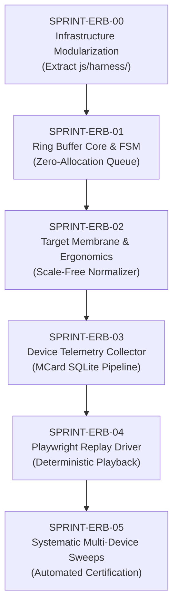

# Active Sprint Series: LandingPage as Device-Sensitive Testing Infrastructure

## Executive Summary
This sprint series specifies, aligns, and executes the transformation of `LandingPage` into an industrial-grade **Infrastructure for Testing Device-Sensitive Functionalities** on a chosen LandingPage target URL (e.g. `http://localhost:4321/` or configured staging build).

Through an explicit **sequence of refactoring actions**, the monolithic laboratory workbench is decomposed into modular test harness components, an in-memory event capture ring buffer, scale-free spatial normalizers, runtime telemetry observers, and an automated Playwright replay and certification engine.

This work is executed using the **BMAD (BMM) Multi-Agent Framework** orchestrated under **`poteto-mode` (pstack)** engineering rigor.

---

## 🎯 Device-Sensitive Functionalities Under Test
When pointing the testing infrastructure to a chosen web target, it systematically tests and certifies:
1. **Geometric Adaptability & Orientation Reflow (`INV-RVP-01`)**: Instant dimension exchange between portrait and landscape modes with zero layout distortion or clipping.
2. **Horizontal Viewport Bleed (`INV-DEV-01`)**: Zero content overflow or unexpected horizontal scrollbars (`scrollWidth <= innerWidth`).
3. **Touch Target Ergonomics (`INV-DEV-02`)**: Compliance with minimum touch interaction bounds ($\ge 44\text{px} \times 44\text{px}$) on mobile devices.
4. **Scale-Free Event Recording (`INV-ERB-01..03`)**: Lossless in-memory ring buffering of user and automated interaction streams with coordinates normalized to unscaled space $[0.0, 1.0]$.
5. **Runtime Telemetry & Layout Stability (`INV-DEV-04`)**: Frame budget adherence ($16.6\text{ms}$ / $60\text{fps}$) and layout stability under rapid viewport reflows.
6. **MCard Test Dataset Certification**: Persistent, content-addressed storage of test results in SQLite Triad (`data/mcard-api.db`) with `clm-kernel` hashing (`blake3`).

---

## BMAD Agent Roster & RACI Matrix

| BMAD Role | Agent Persona | Primary Responsibility | pstack Focus |
| :--- | :--- | :--- | :--- |
| **Architect** | Winston | Module decomposition, data models, pointer arithmetic, invariants (`INV-ERB-01..03`, `INV-DEV-01..04`) | `principle-model-the-domain`, `architect` |
| **Dev** | Amelia | Reusable harness modules (`js/harness/`), state machine, target binding, and storage adapters | `tdd`, `principle-laziness-protocol` |
| **TEA** | Murat | Playwright test suites, systematic multi-device sweep matrix, replay driver, CI verification | `principle-prove-it-works`, `tdd` |
| **Analyst** | Sophia | Requirement boundaries, certification schemas, and acceptance criteria | `principle-boundary-discipline` |
| **SM** | Bob | DoD verification, sprint transitions, and DoD sealing contracts | `principle-sequence-verifiable-units` |
| **Tech Writer** | Paige | Infrastructure documentation, test dataset registries, API guides, and changelog maintenance | `technical-writing`, `unslop` |

---

## Refactoring & Sprint Roadmap

| Sprint Code | Title | Status | Primary Artifacts | Verification Gate |
| :--- | :--- | :--- | :--- | :--- |
| **[SPRINT-ERB-00](./SPRINT-ERB-00-infrastructure-refactoring.md)** | Infrastructure Modularization & Harness Refactoring | 🟡 SPECIFICATION | `js/harness/viewport-stage.js`, `js/harness/target-membrane.js` | Zero regression on `responsive-rotation-and-devices.spec.js` |
| **[SPRINT-ERB-01](./SPRINT-ERB-01-ring-buffer-core.md)** | Ring Buffer Core & State Engine | 🟡 SPECIFICATION | `js/harness/event-ring-buffer.js` | `node --test tests/unit/event-ring-buffer.test.mjs` |
| **[SPRINT-ERB-02](./SPRINT-ERB-02-membrane-normalization.md)** | Target Membrane & Touch Ergonomics | 🟡 SPECIFICATION | `js/harness/membrane-interceptor.js`, `responsive-lab.html` | Invariant coordinate tests ($nx, ny \in [0.0, 1.0]$) on chosen target URL |
| **[SPRINT-ERB-03](./SPRINT-ERB-03-mcard-clm-persistence.md)** | Telemetry Collector & MCard Dataset Pipeline | 🟡 SPECIFICATION | `js/harness/telemetry-collector.js`, `server/mcard-session-adapter.mjs` | `node --test tests/unit/mcard-session-storage.test.mjs` |
| **[SPRINT-ERB-04](./SPRINT-ERB-04-playwright-deterministic-replay.md)** | Deterministic Playwright Replay Driver | 🟡 SPECIFICATION | `scripts/playwright-replay-driver.mjs`, `tests/features/responsive-replay.spec.js` | `npx playwright test tests/features/responsive-replay.spec.js` |
| **[SPRINT-ERB-05](./SPRINT-ERB-05-device-sensitive-systematic-sweeps.md)** | Systematic Multi-Device Sweeps & Certification | 🟡 SPECIFICATION | `tests/features/systematic-landing-test.spec.js` | `TARGET_URL=http://localhost:4321/ npm run test:responsive` |

---

## Core Invariants Enforced Across All Sprints
- **`INV-STU-01 (Single Target Focus)`**: All capture, telemetry collection, and replay drivers bind to a single, explicit LandingPage target URL.
- **`INV-INF-01 (Zero Regression Guarantee)`**: Modularization of `responsive-lab.html` must preserve 100% of existing Playwright assertions.
- **`INV-ERB-01 (Bounded Footprint)`**: Ring buffer capacity $N \le 2048$ entries; fixed memory ceiling, zero allocation on hot path, clean drop tracking.
- **`INV-ERB-02 (Scale-Independent Coordinates)`**: Normalization relative strictly to unscaled device dimensions ($w_{\text{target}}, h_{\text{target}}$), independent of stage scale factor $s$.
- **`INV-ERB-03 (State Machine Determinism)`**: Strict states (`IDLE`, `RECORDING`, `PAUSED`, `FINALIZED`).
- **`INV-RVP-01 (Dynamic 2D Geometry & Rotation)`**: Full dimension swapping on orientation change preserved without layout distortion.
- **`INV-DEV-01..04 (Device-Sensitive Invariants)`**: Zero horizontal bleed, touch target $\ge 44\text{px}$, rotation parity, and frame latency $\le 20\text{ms}$.
