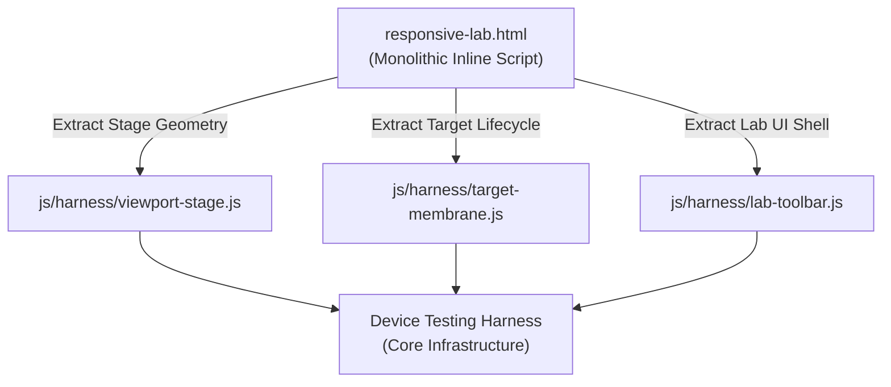

# Sprint ERB-00: Infrastructure Modularization & Device Harness Refactoring

## Metadata
- **Sprint Code**: `SPRINT-ERB-00`
- **Handle**: `urn:pcard:sprint:SPRINT-ERB-00`
- **Status**: `SPECIFICATION`
- **Archetype**: `ClmTriadManifest`
- **pstack Playbook**: `refactoring` + `principle-boundary-discipline` + `principle-subtract-before-you-add`

---

## 1. Context & Objective
Currently, `responsive-lab.html` contains an embedded monolithic `<script>` (~450 lines) handling DOM selection, device registry subscriptions, layout scaling, orientation swaps, and modal controls in one coupled block. 

To transform `LandingPage` into an industrial-grade **infrastructure for testing device-sensitive web applications** (such as `http://localhost:4321/` or `app.html`), we must execute a disciplined sequence of refactoring actions. This sprint decouples the stage runner from the laboratory UI, extracts reusable ESM modules into `js/harness/`, and defines clean interfaces for viewport geometry, device profiles, and target URL binding.

---

## 2. Refactoring Sequence



### Step 0.1: Extract `js/harness/viewport-stage.js`
- **Responsibility**: Pure viewport stage geometry, rotation (`INV-RVP-01`), containment scaling (`INV-RVP-02`), and stage containment math:
  $$s = \min\left(1, \frac{W_{\text{available}}}{w_{\text{target}}}, \frac{H_{\text{available}}}{h_{\text{target}}}\right)$$
- **Interface**:
  - `setViewportSize(width, height, unit, label)`
  - `setOrientation('horizontal' | 'vertical')`
  - `rotate()`
  - `recomputeScale(containerRect)`
  - `getGeometry(): { width, height, orientation, scale, unit }`
- **Boundary**: Zero dependency on UI toolbar buttons or DOM modals. Interacts solely with the stage wrapper and CSS variables.

### Step 0.2: Extract `js/harness/target-membrane.js`
- **Responsibility**: Lifecycle of the embedded target iframe (`#mission-control-iframe`).
- **Interface**:
  - `bindTarget(url: string): Promise<TargetStatus>`
  - `getTargetUrl(): string`
  - `getIframeWindow(): Window | null`
  - `getIframeRect(): DOMRect`
  - `checkSandboxPolicy(url: string): { allowed: boolean, reason?: string }`
- **Target Ingestion**: Handles `?target=<URL>` query parameter binding and dispatches target load events.

### Step 0.3: Modularize `responsive-lab.html`
- Replace monolithic inline logic with an ESM boot script importing from `js/harness/`.
- Preserve existing public debug hooks:
  - `window.__set_controlled_panel_width`
  - `window.__set_controlled_orientation`
  - `window.__get_viewport_geometry`
  - `window.__device_registry`

---

## 3. BMAD Agent Responsibilities

### 🏛️ Architect (Winston)
- Define module contracts in `js/harness/` and enforce strict separation of concerns.
- Enforce **`INV-INF-01` (Zero Regression Guarantee)**: Existing Playwright feature tests (`tests/features/responsive-rotation-and-devices.spec.js`) must pass without modifying test assertions.

### 💻 Dev (Amelia)
- Create `js/harness/viewport-stage.js` and `js/harness/target-membrane.js`.
- Refactor `responsive-lab.html` to consume modules via native `<script type="module">`.
- Ensure clean fallback when running offline or without external bundlers.

### 🧪 Test Engineering Architect (TEA - Murat)
- Run regression suite before and after refactoring:
  - `npx playwright test tests/features/responsive-rotation-and-devices.spec.js`
  - `npx playwright test tests/features/layout-freeze.spec.js`
- Verify that `--frame-scale-factor` and orientation toggle behaviors remain byte-for-byte identical.

---

## 4. Definition of Done (DoD) & Verification

- [ ] `vcard:sprint-erb-00:viewport_stage_extracted`: `js/harness/viewport-stage.js` created and unit-tested.
- [ ] `vcard:sprint-erb-00:target_membrane_extracted`: `js/harness/target-membrane.js` handles target URL binding and query parameters.
- [ ] `vcard:sprint-erb-00:html_monolith_eliminated`: `responsive-lab.html` inline script reduced to clean initialization orchestrator.
- [ ] `vcard:sprint-erb-00:zero_regression_verified`: All 497 lines of `responsive-rotation-and-devices.spec.js` pass cleanly without modifications.

### Execution Command:
```bash
npx playwright test tests/features/responsive-rotation-and-devices.spec.js
```
