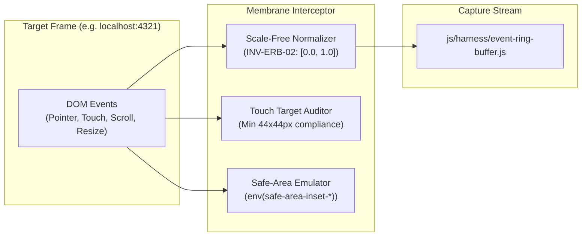

# Sprint ERB-02: Target Membrane Interceptor, Device-Sensitive Ergonomics & Spatial Normalization

## Metadata
- **Sprint Code**: `SPRINT-ERB-02`
- **Handle**: `urn:pcard:sprint:SPRINT-ERB-02`
- **Status**: `SPECIFICATION`
- **Archetype**: `ClmTriadManifest`
- **pstack Playbook**: `feature` + `principle-boundary-discipline` + `principle-experience-first`

---

## 1. Context & Objective
Intercept user and automated interaction streams inside the Responsive UI Lab iframe (`#mission-control-iframe`) specifically bound to a **chosen LandingPage target URL** (e.g., `http://localhost:4321/` or `app.html`). 

This sprint implements the **device-sensitive testing membrane** at `js/harness/membrane-interceptor.js`. It captures touch, mouse, gesture, and orientation events, validates touch ergonomics (tap target compliance $\ge 44\text{px} \times 44\text{px}$), emulates mobile safe-area insets, and normalizes all spatial coordinates to $[0.0, 1.0]$ so that capture fidelity is strictly invariant to stage scaling factor $s$ (`INV-ERB-02`) and device rotation (`INV-RVP-01`).

---

## 2. Refactoring & Implementation Sequence



### Step 2.1: Implement Scale-Free Spatial Normalizer (`INV-ERB-02`)
- Compute iframe client bounding rect dynamically:
  $$nx = \frac{e.\text{clientX} - \text{rect}.\text{left}}{\text{rect}.\text{width}}, \quad ny = \frac{e.\text{clientY} - \text{rect}.\text{top}}{\text{rect}.\text{height}}$$
- Because both numerator and denominator scale proportionally with `--frame-scale-factor: s`, the scale factor $s$ cancels out completely, ensuring $nx, ny$ are 100% resolution- and zoom-invariant.

### Step 2.2: Device-Sensitive Ergonomics & Safe-Area Emulation
- **Touch Target Auditor**: On every click/tap event, check target bounding box. If dimensions $< 44\text{px} \times 44\text{px}$ on mobile device presets, flag with warning `ergonomics_violation: tap_target_undersized`.
- **Safe-Area Insets**: Inject CSS custom properties `--safe-area-top`, `--safe-area-bottom` into target iframe to simulate iPhone dynamic island and home indicator bar.

### Step 2.3: Device Rotation Marker (`INV-RVP-01`)
- Listen to `viewport-stage` orientation swap events.
- Emit `orientation_change` event into the ring buffer containing both previous and newly applied viewport dimensions.

---

## 3. BMAD Agent Responsibilities

### 🎨 UX Designer (Evelyn)
- Design touch ergonomic warning markers and safe-area notch overlays on the stage.
- Update `responsive-lab.html` control ribbon with recording badge, event count, and tap target health indicator.

### 🏛️ Architect (Winston)
- Enforce **`INV-STU-01` (Single Target Focus)**: All listeners and normalization pipeline are configured around the designated target URL.
- Enforce **`INV-ERB-02` (Scale-Free Coordinates)**: Invariant $nx, ny \in [0.0, 1.0]$.
- Ensure membrane boundary handles both same-origin targets (`app.html`) and local development servers (`http://localhost:4321/`) gracefully.

### 💻 Dev (Amelia)
- Implement `js/harness/membrane-interceptor.js`.
- Integrate passive event listeners with `requestAnimationFrame` throttling for high-frequency scroll and drag events.
- Connect interceptor to `EventRingBuffer`.

### 🧪 Test Engineering Architect (TEA - Murat)
- Build automated Playwright assertion testing the normalization formula:
  - Load `responsive-lab.html?target=http://localhost:4321/` with scaled viewport ($s < 1$).
  - Trigger clicks at four known corners of the target frame ($0\%, 0\%$), ($100\%, 100\%$), etc.
  - Assert normalized coordinates match within $\pm 0.01$ tolerance across multiple device presets.

---

## 4. Definition of Done (DoD) & Verification

- [ ] `vcard:sprint-erb-02:membrane_interceptor_implemented`: `js/harness/membrane-interceptor.js` intercepts events cleanly.
- [ ] `vcard:sprint-erb-02:scale_free_normalization_verified`: Coordinates are proven invariant across `--frame-scale-factor` ranges ($0.25 \le s \le 1.0$).
- [ ] `vcard:sprint-erb-02:touch_ergonomics_auditing`: Flags tap targets below $44\text{px} \times 44\text{px}$ on mobile viewports.
- [ ] `vcard:sprint-erb-02:rotation_event_logging`: Orientation toggling logs `orientation_change` with swapped target dimensions per `INV-RVP-01`.

### Execution Command:
```bash
npx playwright test tests/smoke/responsive-lab.spec.js
```
