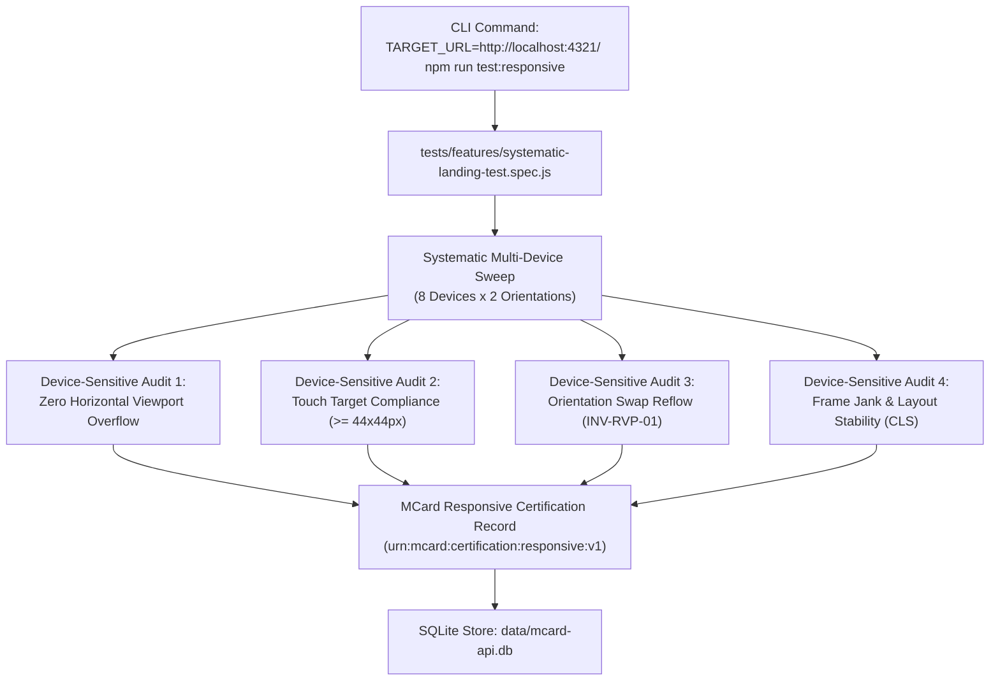

# Sprint ERB-05: Device-Sensitive Systematic Sweeps & MCard Certification

## Metadata
- **Sprint Code**: `SPRINT-ERB-05`
- **Handle**: `urn:pcard:sprint:SPRINT-ERB-05`
- **Status**: `SPECIFICATION`
- **Archetype**: `ClmTriadManifest`
- **pstack Playbook**: `feature` + `principle-prove-it-works` + `principle-build-the-lever`

---

## 1. Context & Objective
This sprint delivers the culmination of the infrastructure: a fully automated, headless **Systematic Multi-Device Sweep Matrix** that certifies any chosen LandingPage URL (e.g., `http://localhost:4321/` or `app.html`) for device-sensitive compatibility.

The test suite sweeps the chosen target across mobile, tablet, and desktop form factors in both portrait and landscape orientations, evaluates touch ergonomics, audits layout stability, captures interaction telemetry, and mints an **MCard Responsive Quality Certification** directly into the SQLite Triad store (`data/mcard-api.db`).

---

## 2. Refactoring & Implementation Sequence



### Step 5.1: Implement Systematic Sweep Suite (`tests/features/systematic-landing-test.spec.js`)
- Parameterize with `TARGET_URL`:
  ```javascript
  const TARGET_URL = process.env.TARGET_URL || 'http://localhost:4321/';
  ```
- **Standard Device Matrix**:
  1. `iphone-16-pro`: $393 \times 852$ px (DPR 3.0, Portrait & Landscape)
  2. `galaxy-s24`: $360 \times 780$ px (DPR 3.0, Portrait & Landscape)
  3. `pixel-8`: $412 \times 915$ px (DPR 2.625, Portrait & Landscape)
  4. `ipad-air-11`: $820 \times 1180$ px (DPR 2.0, Portrait & Landscape)
  5. `desktop-fhd`: $1920 \times 1080$ px (DPR 1.0, Landscape)

### Step 5.2: Device-Sensitive Invariant Assertions
- **`INV-DEV-01 (Zero Horizontal Bleed)`**: For every viewport, assert `document.documentElement.scrollWidth <= window.innerWidth`.
- **`INV-DEV-02 (Touch Target Ergonomics)`**: For interactive buttons/links on mobile devices, assert bounding box $w \ge 44\text{px} \land h \ge 44\text{px}$ or valid spacing margin.
- **`INV-DEV-03 (Orientation Inversion Parity)`**: Trigger orientation toggle; assert header and content reflow completely within viewport bounds without layout freeze.
- **`INV-DEV-04 (Frame Rate Budget)`**: Under rapid scrolling/rotation, assert average frame latency $\le 20\text{ms}$ ($\ge 50\text{fps}$).

### Step 5.3: Automated Certification MCard Minting
- Compile sweep results into an MCard artifact (`urn:mcard:certification:responsive:v1`).
- Post to `/api/mcard/session/save` to commit certification to the database.
- Output clean terminal summary table with pass/fail badges.

---

## 3. BMAD Agent Responsibilities

### 🧪 Test Engineering Architect (TEA - Murat)
- Architect `tests/features/systematic-landing-test.spec.js`.
- Add npm script in `package.json`: `"test:responsive": "playwright test tests/features/systematic-landing-test.spec.js"`.
- Implement CLI reporter output formatting.

### 💻 Dev (Amelia)
- Connect test runner to MCard API for certification storage.
- Support environment variables: `TARGET_URL`, `FAST_MODE=1`, `HEADED=1`.

### 📋 Analyst (Sophia)
- Formalize DoD criteria for responsive certification: all 5 devices must pass horizontal bleed and orientation reflow tests.

### 📝 Tech Writer (Paige)
- Author `docs/08-testing/DEVICE_SENSITIVE_TESTING_INFRASTRUCTURE.md` documenting how to use LandingPage as an infrastructure to test any web application.

---

## 4. Definition of Done (DoD) & Verification

- [ ] `vcard:sprint-erb-05:systematic_test_implemented`: `tests/features/systematic-landing-test.spec.js` sweeps target across device matrix.
- [ ] `vcard:sprint-erb-05:device_sensitive_invariants_enforced`: `INV-DEV-01` through `INV-DEV-04` asserted on every device preset.
- [ ] `vcard:sprint-erb-05:certification_card_minted`: Finalized certification MCard stored in `data/mcard-api.db`.
- [ ] `vcard:sprint-erb-05:multi_target_validated`: Test runs successfully against both `TARGET_URL=http://localhost:4321/` and `TARGET_URL=app.html`.
- [ ] `vcard:sprint-erb-05:docs_published`: Complete guide published in `docs/08-testing/DEVICE_SENSITIVE_TESTING_INFRASTRUCTURE.md`.

### Execution Command:
```bash
TARGET_URL=http://localhost:4321/ npm run test:responsive
```
